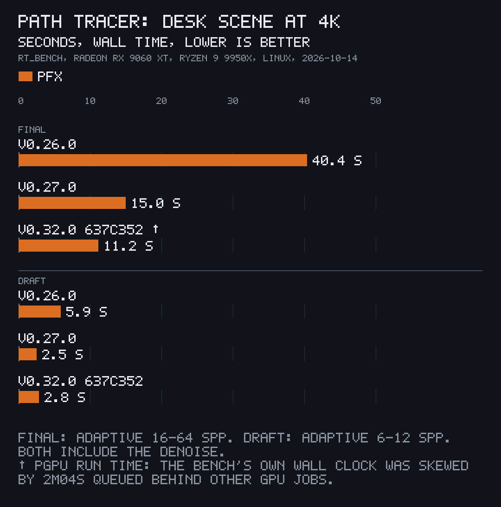
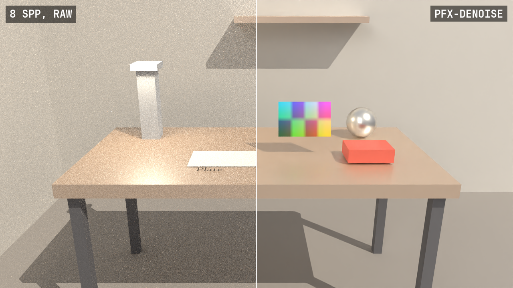
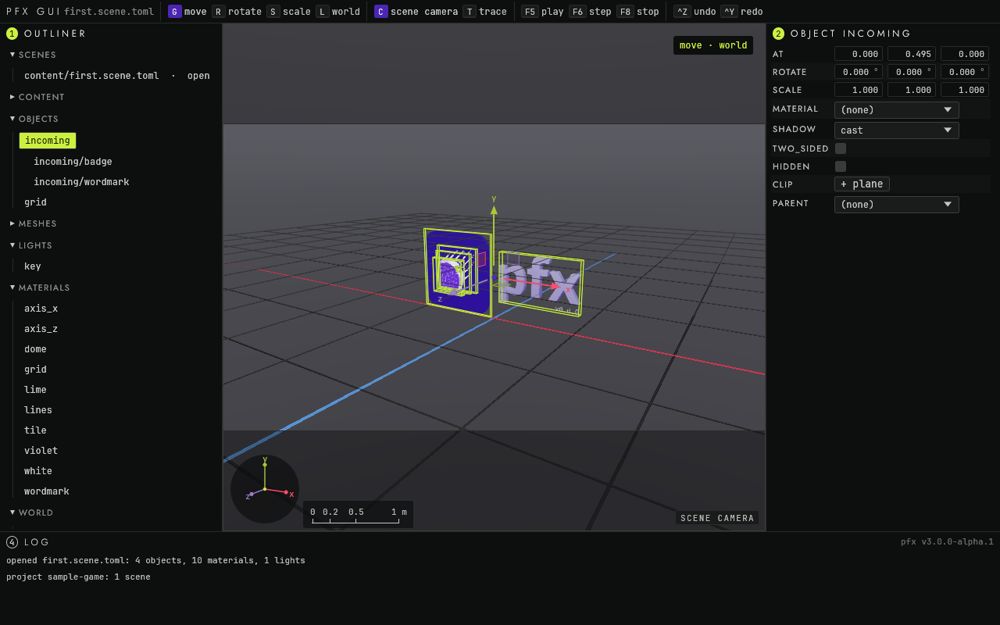
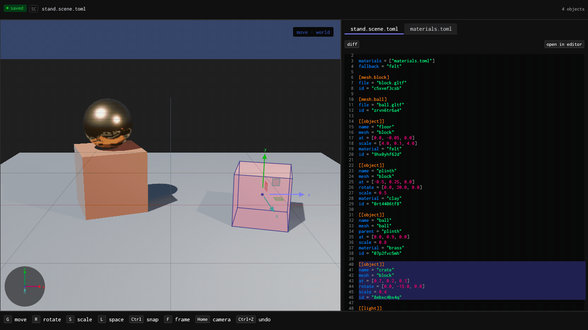

<p align="center"></p>

# pfx

[](https://github.com/gmrdad82/pfx/actions/workflows/ci.yml) [](https://github.com/gmrdad82/pfx/tags)

pfx is a game and render engine in Rust, part of [PITO MD](https://pitomd.com): a live renderer for 60 fps at 4K, an offline path tracer with its own denoiser, physics, sound, input, mods and a scene editor, with scenes kept as plain TOML files. It is built to be fast, light and simple, and every number below was measured on this repository's code.

| | Measured |
|---|---|
| Live renderer, 4K, neutral room | **4.4 ms** GPU a frame (p50), 4.8 ms p99, 0 dropped frames in 1,200 |
| 2D pass, 4K, 2,000 shots + 20,301 particles | **0.39 ms** GPU a frame |
| Path tracer, desk scene, 4K final, denoised | **11.2 s**, down from 40.4 s in v0.26.0 |
| Denoiser, 4K | **287 ms** on the GPU |
| Empty game, stripped release binary | **34.7 MB** against Bevy's 106.6 MB |
| Empty game, dependency crates | **290** against Bevy's 392 |

How each was measured is under [The numbers](#the-numbers).

## Install and first use

The `pfx` tool runs on Linux with a Vulkan GPU. Install it with Rust 1.97 or newer (on Debian or Ubuntu, first `sudo apt install libasound2-dev libudev-dev libxkbcommon-dev libwayland-dev libx11-dev`):

```
cargo install --locked --git https://github.com/gmrdad82/pfx --tag v1.0.0 pfx
```

Then make a game, play it and open it in the editor:

```
git init my-game
pfx new my-game
cd my-game
cargo run --release
cargo run --release -- edit
```

<p align="center"></p>

The game is a type that implements `pfx_game::Game`; `main` hands it to the launcher, which runs the window, pacing, input, sound and a fixed tick:

```rust
use pfx_game::{Config, Game, Input, Tick, World};

struct MyGame;

impl Game for MyGame {
    fn start(&mut self, _world: &mut World) {}

    fn tick(&mut self, _world: &mut World, _tick: &Tick, _input: &Input) {}
}

fn main() -> std::process::ExitCode {
    let config = Config::new("my-game", env!("CARGO_PKG_VERSION"), "content/first.scene.toml");
    pfx_game::launch(|| MyGame, config, |_commands| {})
}
```

Games built on pfx build and pass their tests on Linux and Windows in CI, build for macOS on Apple Silicon in CI, and run on the Steam Deck through Proton ([docs/windows.md](docs/windows.md)). A game links the crates it uses by the same tag:

```toml
pfx-game = { git = "https://github.com/gmrdad82/pfx", tag = "v1.0.0" }
```

## The live renderer

<p align="center"></p>

The live renderer keeps 60 fps at 4K with shadows, baked light, TAA, text drawn from vector outlines, effects and dynamic resolution ([docs/live-renderer.md](docs/live-renderer.md)). On the neutral room at 3840x2160 a frame costs 4.4 ms of GPU time at the median and 4.8 ms at p99, about a quarter of the 16.7 ms a 60 fps frame allows, and the CPU's simulate-and-submit takes 1.8 ms at the median. It draws frames on demand: when only the camera drifts a desk frame costs 0.50 ms, and an idle scene costs nothing.

<p align="center"></p>

The flat 2D pass draws sprites, text and particles for 2D games and overlays ([docs/flat.md](docs/flat.md)). At 4K, 2,000 shots and 20,301 particles cost 0.39 ms of GPU time a frame.

<p align="center"></p>

## The path tracer

<p align="center"></p>

pfx-trace renders stills, clips and the light bake on the GPU ([docs/trace.md](docs/trace.md), [docs/bake.md](docs/bake.md)). It traces with hardware ray queries wherever the device offers them (Vulkan, DX12, Metal on Apple Silicon) and with its own BVH elsewhere, samples with Cycles' tabulated Sobol sequence, and stops each pixel when it has converged. The desk above, at 4K, takes 11.2 s as a final and 2.8 s as a draft, denoising included.

<p align="center"></p>

## The denoiser

<p align="center"></p>

pfx-denoise is Intel Open Image Denoise 2.5.1's RT filter ported to wgpu compute: a traced colour with its albedo and normal go in, the clean colour comes out, equal to OIDN's own output to about 1e-5 ([docs/denoise.md](docs/denoise.md)). A 4K frame takes 287 ms on the GPU. It runs on every `pfx render` final and draft, so a few samples a pixel are enough.

## The editor

<p align="center"></p>

`pfx edit` and `<game> edit` open a scene in the editor, with an outliner, an inspector, gizmos, play in the viewport and live gameplay modules ([docs/editor.md](docs/editor.md)). Every edit is written back into the scene's TOML in place, so a scene stays a text file you can diff and review. Its egui crates are reusable on their own ([docs/editor-crates.md](docs/editor-crates.md)):

<p align="center"></p>

## The rest of a game

Rigid bodies, characters and world queries ([docs/physics.md](docs/physics.md)); mixing, streams and music ([docs/sound.md](docs/sound.md)); keyboard, mouse and controllers behind one action map ([docs/input.md](docs/input.md)); shots, emitters, a spawn director and input journals for arcade games ([docs/shots.md](docs/shots.md), [docs/director.md](docs/director.md), [docs/journal.md](docs/journal.md)); sandboxed WASM mods ([docs/mods.md](docs/mods.md)); and Steam ([docs/steam.md](docs/steam.md)). The same scene, inputs and seed give the same frames on the same GPU and driver, and a game's rules run bit for bit from their seed ([docs/sim.md](docs/sim.md)).

Each of these costs a small slice of a frame:

<p align="center"></p>

## Small and light

An empty game made by `pfx new`, against an empty Bevy app with its default plugins, both built cold with `cargo build --release` on the same machine:

<p align="center">


</p>

That pfx game carries the editor; built without it (`--no-default-features`, what a Steam build ships) it is 25.3 MB stripped with 251 dependency crates. Bevy's starter brings its full renderer, UI and audio, so this compares the two starters as they ship, not equal features. The engine is 30 crates and about 278,000 lines of Rust, and the domain code it needs (the denoiser, the Sobol sampler, the resampler) is ported into it rather than linked.

## The numbers

Measured once on 2026-10-14 at commit 637c352 (v0.32.0), on an AMD Radeon RX 9060 XT with an AMD Ryzen 9 9950X (32 threads) under Linux, each GPU run through the machine's GPU queue, which other jobs shared:

- **Live, 4K:** `pfx bench <room>.scene.toml --seconds 20 --size 3840x2160` on the neutral bench room (`crates/load/tests/scenes`, with a falling ball and a turning pillar), 1,200 frames. The CPU p99 (10.5 ms) is skewed: the queue held the job for part of the run.
- **Frames on demand:** `crates/live/examples/frames.rs`, the desk at 4K: every frame 4.9 ms GPU at the median, a drifting camera 0.50 ms, idle 0.
- **2D pass:** the swarm test in `crates/live/tests/flat/`, 2,000 shots and 20,301 particles at 4K, GPU p50 0.39 ms, p99 0.61 ms.
- **Path tracer:** `crates/denoise/examples/rt_bench.rs time desk final|draft 3840 2160`, the desk scene in `crates/bake/tests/plates/`, adaptive 16-64 samples a pixel for a final and 6-12 for a draft, denoise included. The final's 11.2 s is the queue's run time: the bench's own clock also counted 2 min 4 s it waited for the GPU. v0.26.0 and v0.27.0 were measured with the same bench at their tags, with the PCG sampler at 32-128 and 8-16 samples, which Sobol matches in noise since v0.28.0.
- **Denoiser:** `crates/denoise/examples/compare.rs bench 3840 2160`, median texture to texture (623 ms with upload and readback, 673 ms on a first call that builds the pipelines).
- **Game systems:** the bench tests in pfx-core and pfx-sound (`cargo test --release -p pfx-core --features serde --lib -- --ignored bench_`, `cargo test --release -p pfx-sound --test bench -- --ignored`), one thread. A sound tick is 800 frames at 48 kHz, with cubic resampling, the default for short sounds.
- **Size:** pfx v0.32.0's scaffold and Bevy 0.20.0 with `DefaultPlugins`, cargo's default release profile, 4 build jobs, one cold build each in turn; binaries measured after `strip`; dependency crates counted with `cargo tree -e normal`, the game itself excluded. Lines of Rust counted with `wc -l` over `crates/*/src` and `src`.

Nothing here was run twice for a better number. Hardware ray queries on Windows are built but untested on NVIDIA, Intel and AMD Windows machines.

## The crates

Each is a package in this workspace that a game or app can link by tag:

| Package | What it does |
|---|---|
| `pfx-core` | springs, easings and tweens ([docs/easings.md](docs/easings.md)); daylight and the sun; camera rigs and animation; deterministic maths, shots, the spawn director, journals, numbers and words |
| `pfx-geom` | levels of detail, analytic shapes as meshes, deformable surfaces, SVG marks as bevelled solids |
| `pfx-gpu` | the wgpu device, offscreen targets, readback and uploads, GPU timing and pacing; windows and screens behind `window` |
| `pfx-materials` | one physically based material for both renderers, with ageing and a WGSL BSDF library |
| `pfx-text` | glyphs from vector outlines (coverage and MSDF atlases), laid along any baseline |
| `pfx-post` | the finish chain (tone map, bloom, grade, vignette, grain, dither) and image styles |
| `pfx-load` | meshes, images, HDR skies and fonts, scenes in [pfx-scene](https://github.com/gmrdad82/pfx-scene)'s format with in-place edits, and a content-addressed cache |
| `pfx-physics` | rigid bodies, character controllers and world queries, fluid, ripples, rope, flocks and wind |
| `pfx-sound` | live mixing, decoded streams and deterministic mixdown |
| `pfx-input` | keyboard, mouse and controllers behind one action map, glyphs, keycaps in the player's layout, rumble and recording |
| `pfx-steam` | achievements, stats, Cloud saves, the overlay, rich presence, leaderboards, lobbies and Steam Input |
| `pfx-live` | the live renderer: shadows, baked light, TAA, text, effects, the flat 2D pass, frames on demand, dynamic resolution and the dev HUD |
| `pfx-trace` | the offline path tracer |
| `pfx-denoise` | Intel Open Image Denoise's RT filter ported to wgpu compute |
| `pfx-bake` | path-traced light the live renderer shows at raster cost: probe grids, lightmaps and plates |
| `pfx-play` | play mode: a game run live over a runtime copy of a scene, with pause, step and an exact stop |
| `pfx-game` | the game runtime and its command-line launcher |
| `pfx-project` | a game's `project.toml`, scenes and content folders, and `pfx new`'s scaffold |
| `pfx-mod` | the mod host: sandboxed, deterministic WASM components, metered by fuel and capped in memory |
| `pfx-editor` | `pfx edit` and `<game> edit`: the scene editor, with play in the viewport and live gameplay modules |
| `pfx-editor-style`, `-shell`, `-doc`, `-toml`, `-viewport` | the egui crates editors on pfx share: a theme and its widgets, a window host with an offscreen shot harness, document edits on one undo history, a TOML source panel and a 3D scene viewport with picking and a gizmo |
| `pfx-theme` | the colours, fonts and type the editor and the dev HUD paint with |
| `pfx-bench` | `pfx bench` |
| `pfx-assets` | path-traced renders of logos, icons and scenes from SVG masters and small specs |
| `pfx-run` | the `pfx` tool's process plumbing: GPU queueing, ending children cleanly and the system ffmpeg |

The `pfx` tool's commands:

```
pfx new <game>                           scaffold a game
pfx edit <scene.toml | project folder>   the scene editor
pfx bench <scene.toml> --seconds 10      a repeatable headless load with frame stats
pfx bake --scene <dir>                   path-traced probes, lightmaps and plates
pfx render --scene <shot> --product <product> --still
pfx steam stage --manifest <game>/steam.toml --out tmp/steam
pfx scene migrate|fix <scene.toml>
pfx --help
```

## Part of PITO MD

pfx is the engine under the [PITO MD](https://pitomd.com) games and apps. It is generic: no game keeps its names, values or assets in it; each game owns its content and uses the engine ([docs/agnostic.md](docs/agnostic.md)). It works with:

- [pfx-scene](https://github.com/gmrdad82/pfx-scene), the TOML scene format pfx reads and the editor writes in place.
- [Manfred](https://github.com/gmrdad82/manfred), which builds and views scenes on pfx's renderers.
- [prec](https://github.com/gmrdad82/prec), [pconv](https://github.com/gmrdad82/pconv) and [pito-compare](https://github.com/gmrdad82/pito-compare), which recorded, encoded and charted this page.

## Build and test

```
cargo build --release
bin/gate
```

`bin/gate` is what CI runs, one phase per job in parallel: `lint` (formatting, clippy with warnings as errors, the check that keeps game content out of the engine and the licence check of every dependency), `tests` (the binaries, examples, unit, integration and doc tests), `release` (the optimised `pfx` binary), `windows` (the game crates' clippy and tests on Windows) and `macos` (the game crates on macOS). With no phase it runs `lint` and `tests`. CI also runs nightly on main. The GPU tests are `#[ignore]`d and need a GPU: run a crate's with `cargo test -p <crate> -- --ignored`.

## Contributing

Issues and pull requests are welcome at [github.com/gmrdad82/pfx](https://github.com/gmrdad82/pfx). Keep `bin/gate` green, keep game-specific names, values and assets out of the engine, and follow the [code of conduct](CODE_OF_CONDUCT.md). Report a vulnerability privately, as [SECURITY.md](SECURITY.md) says.

## Licence

<picture><source media="(prefers-color-scheme: dark)" srcset="assets/marks/lockup.svg"></picture>

The code is MIT licensed, © Catalin Ilinca ([LICENSE](LICENSE)). The MIT licence covers the code only: the PITO MD name, every app and game name and their logos are © Catalin Ilinca, all rights reserved ([TRADEMARKS.md](TRADEMARKS.md)). Fonts and other media keep their own licences ([NOTICE.md](NOTICE.md)).
