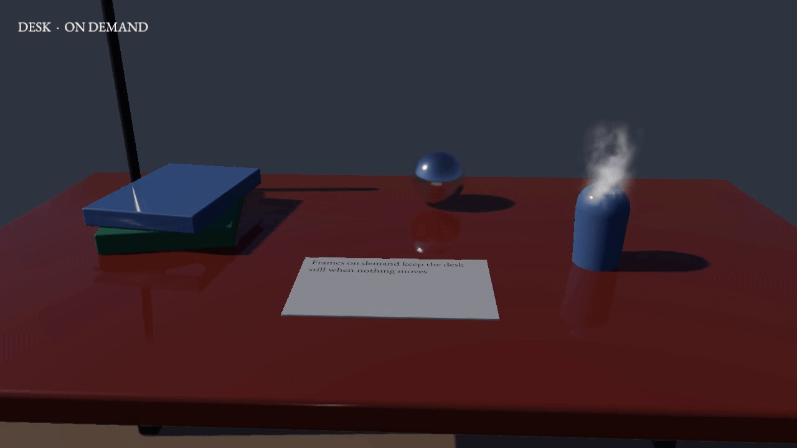
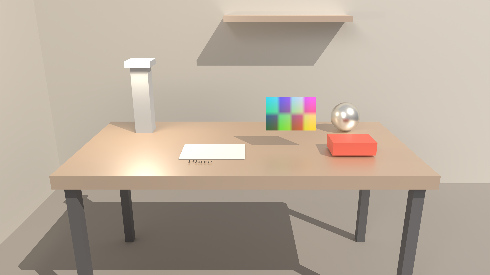

<p align="center"></p>

# pfx

[](https://github.com/gmrdad82/pfx/tags)

pfx is a game and render engine in Rust, part of [PITO MD](https://pitomd.com). It draws scenes live at 4K, path-traces stills and clips with its own denoiser, builds scenes from recipes, edits them in its own editor, plays them with a game's WebAssembly module, and runs the physics, sound, input and Steam a game needs. It is one tool, `pfx`, and a set of library crates a game links. It is built to be fast, light and simple, and every number below was measured on this repository's code.

| | Measured | Source |
|---|---|---|
| Live renderer, 4K, neutral room | **4.4 ms** GPU a frame (p50 and p99), 0 dropped in 1,200 | [measured.md](docs/measured.md#live-4k) |
| 2D pass, 4K, 2,000 shots + 20,301 particles | **0.36 ms** GPU a frame | [measured.md](docs/measured.md#2d-pass) |
| Path tracer, 4K workshop still, adaptive to 64 samples a pixel | **5,969 ms** GPU | [trace.md](docs/trace.md#the-material-record) |
| Path tracer, 4K, 128 point and spot lights | **4.8 s**, from 9.4 s light by light | [trace-lights.md](docs/trace-lights.md#many-lights-the-light-tree) |
| Live ambient occlusion and contact shadows, 4K, `high` | **2.72 ms** GPU a frame | [live-renderer.md](docs/live-renderer.md#ambient-occlusion-and-contact-shadows) |
| Denoiser, 4K, texture to texture | **274 ms** on the GPU | [denoise.md](docs/denoise.md#speed) |
| `.pitofx` file, car-sized model (159,200 triangles) | **3.4 ms** warm, 7.9 ms cold, at half the GLB's size | [pfx-file.md](docs/pfx-file.md#load-time) |
| Empty game, stripped release binary (v0.32.0) | **34.7 MB** against Bevy's 106.6 MB | [measured.md](docs/measured.md#size) |

How and when each was measured is on its page.

## Install and first use

| | |
|---|---|
| Linux, Windows, macOS | `cargo install --locked --git https://github.com/gmrdad82/pfx --tag v3.1.1 pfx` |

The `pfx` tool builds from source on Linux, Windows and macOS (Apple Silicon); [docs/install.md](docs/install.md) also covers a release's prebuilt archives, their checksums and the `.pitofx` file type each one registers. It needs Rust 1.97 or newer and a GPU wgpu can open: Vulkan on Linux, Vulkan or DX12 on Windows, Metal on macOS. On Debian or Ubuntu, first `sudo apt install libasound2-dev libudev-dev libxkbcommon-dev libwayland-dev libx11-dev`.

`pfx` alone opens the window, `pfx <file.pitofx>` opens that document in it, and any command or flag runs on the command line without one.

Make a game, play it and open it in the editor:

```
git init my-game
pfx new my-game
cd my-game
cargo run --release
cargo run --release -- edit
```

<p align="center"></p>

A game links the crates it uses by the same tag, on Linux, Windows and macOS:

```toml
pfx-game = { git = "https://github.com/gmrdad82/pfx", tag = "v3.1.1" }
```

pfx and its crates build and pass their unit tests on Linux, Windows and macOS (Apple Silicon), and a game's Windows build runs on Linux and the Steam Deck through Proton ([docs/windows.md](docs/windows.md)). [Your first game](docs/first-game.md) walks through it, and [your first recipe](docs/recipe-first-scene.md) builds a scene.

## The .pitofx file

A `.pitofx` is pfx's own file for scenes, recipes and models: TOML inside, in pfx's own container, a chunk table and then each chunk checksummed and compressed on its own with LZ4 (data that is already compressed, such as PNG, is kept as it is), so a reader decodes only the chunks it needs ([docs/pfx-file.md](docs/pfx-file.md)). It is not an archive: no zip tool opens it. A recipe document holds the recipe, every file it reads, its built glTF and the scene built from it, so an unchanged document opens without a rebuild ([docs/recipe-documents.md](docs/recipe-documents.md)).

People edit a `.pitofx` in the editor's inspector or its built-in TOML editor, with syntax highlighting; scripts and agents edit it through the CLI verbs (`set` and `get` by dotted key, `key`, `add`, `remove` and the rest), which write the edit and a fresh build back into the `.pitofx` in one atomic replace. Other tools exchange glTF with pfx (`pfx import`, `pfx export`), never `.pitofx`.

`pfx scene print <file.pitofx>` shows a document's TOML, and `pfx scene write` replaces it from stdin. A plain `.toml` recipe or scene, or a `.pfx` from an older release (magic `PFXFILE`), is imported once into a `.pitofx` beside it with `pfx scene migrate`, or by opening it in the window; every other command refuses it and names that command.

## The renderers

<p align="center"></p>

**Live.** pfx-live keeps 60 fps at 4K with shadows, baked light, TAA, text drawn from vector outlines, effects and dynamic resolution, and draws frames only on demand: an idle scene costs nothing ([docs/live-renderer.md](docs/live-renderer.md)). Its flat 2D pass draws sprites, text and particles for 2D games and overlays ([docs/flat.md](docs/flat.md)).

<p align="center"></p>

**Path-traced.** pfx-trace renders stills, clips and the light bake on the GPU, with hardware ray queries where the device offers them and its own BVH elsewhere, Cycles' tabulated Sobol sequence, and per-pixel adaptive stopping ([docs/trace.md](docs/trace.md), [docs/bake.md](docs/bake.md)). pfx-denoise is Intel Open Image Denoise 2.5.1's RT filter ported to wgpu compute, equal to OIDN's output to about 1e-5 ([docs/denoise.md](docs/denoise.md)), so a few samples a pixel are enough.

## The editor

<p align="center"></p>

`pfx gui` opens a `.pitofx` document, a scene or a project folder in pfx's editor: an outliner, the live viewport with gizmos and picking, the cameras, the lights and sky, a properties inspector, a render panel, a TOML panel with highlighting and checks at line and column, a log and a traced preview, on one undo history ([docs/editor.md](docs/editor.md)). Its theme is black with thin, wide-tracked uppercase titles, a lime accent for what is live, violet for hover and highlights, inset cards and numbered panel markers.

**Play** (F5) runs the open scene as a game in the viewport, and Stop (F8) puts the editor back exactly where it was. With a game's WebAssembly module (`--play <module.wasm>`, the scene's `[play] module`, or a `.wasm` dropped on the window) the game's logic runs in pfx-mod's sandbox, metered and deterministic; the logic stays in the game's own repository ([docs/play-modules.md](docs/play-modules.md)).

## The command line

| | |
|---|---|
| `pfx new <game>` | scaffold a game, its first scene in `content/first.pitofx`; `pfx new <out.pitofx> --from street` writes a starter recipe |
| `pfx`, `pfx <file.pitofx>`, `pfx gui [<path>]` | the editor, with `--play <module.wasm>` |
| `pfx build`, `check`, `timeline` | build a recipe headless into a GLB and a scene, the same bytes on every OS ([docs/recipes.md](docs/recipes.md)) |
| `pfx set`, `get`, `key`, `unkey`, `curve`, `route`, `add`, `remove`, `duplicate` | edit a recipe or a `.pitofx`: values by dotted key, keys, curves, routes and objects |
| `pfx scene list`, `print`, `write`, `save`, `fold`, `migrate`, `fix` | read and write a document's TOML, import `.toml` and legacy `.pfx` files |
| `pfx asset search`, `get`, `list`; `pfx credits <scene>` | find and fetch CC0 and account assets with their licences checked, and list a scene's credits ([docs/asset-sources.md](docs/asset-sources.md)) |
| `pfx import`, `export`, `diff`, `library`, `align` | glTF in and out, GLB diffs, the object library, aligning objects |
| `pfx render --recipe <recipe>`, `pfx shot <recipe> --still` | a path-traced still; a live still |
| `pfx shot <scene.pitofx>`, `pfx clip`, `pfx shoot` | a scene's frames at a fixed clock on the live renderer, a recipe's camera moves and timeline ([docs/render-a-scene.md](docs/render-a-scene.md), [docs/recipe-clips.md](docs/recipe-clips.md)) |
| `pfx film <script>` | a film of clips, frame folders and cards, with transitions and a true-peak ceiling on the master ([docs/film.md](docs/film.md)) |
| `pfx sound clean <in.wav> <out.wav>`, `pfx sound mix <script>` | clean a field recording; render a shot's mix script to a WAV ([docs/sound.md](docs/sound.md)) |
| `pfx bench <scene.pitofx> --seconds N` | a repeatable headless load with frame stats ([docs/benchmark-a-scene.md](docs/benchmark-a-scene.md)) |
| `pfx bake --scene <dir>` | path-traced probes, lightmaps and plates |
| `pfx steam stage --manifest <steam.toml>` | Steam build scripts and depots ([docs/steam.md](docs/steam.md)) |

`pfx --help` lists every command, and `pfx <command> --help` prints its flags.

## The rest of a game

Rigid bodies, characters and world queries ([docs/physics.md](docs/physics.md)); mixing, streams and music ([docs/sound.md](docs/sound.md)); keyboard, mouse and controllers behind one action map ([docs/input.md](docs/input.md)); shots, emitters, a spawn director and input journals ([docs/shots.md](docs/shots.md), [docs/director.md](docs/director.md), [docs/journal.md](docs/journal.md)); sandboxed WASM mods ([docs/mods.md](docs/mods.md)); films rendered offline from a game ([docs/film.md](docs/film.md)); and Steam ([docs/steam.md](docs/steam.md)).

- **Asset sources and credits:** `pfx asset` fetches HDRIs, textures and models from CC0 sources and your accounts, refuses licences you have not allowed, and `pfx credits` lists what a scene uses ([docs/asset-sources.md](docs/asset-sources.md)).
- **Play with a game module:** the window plays the open scene with a game's `.wasm` logic in the sandbox ([docs/play-modules.md](docs/play-modules.md)).
- **Steam Workshop mods:** subscribed Workshop items load as mods beside the local ones ([docs/steam.md](docs/steam.md#workshop-items-as-mods)).
- **Adaptive music:** stems of one tempo follow a live intensity and move between sections on the bar or the beat ([docs/sound.md](docs/sound.md#adaptive-music)).
- **Film transitions and mastering:** `pfx film` cuts between scenes with a dissolve, push or whip, and holds the master under a true-peak ceiling measured as ITU-R BS.1770-4 defines it ([docs/film.md](docs/film.md#transitions), [docs/sound.md](docs/sound.md#true-peak-and-the-limiter)). The same scene, inputs and seed give the same frames on the same GPU and driver ([docs/sim.md](docs/sim.md)). The domain code pfx needs (the denoiser, the Sobol sampler, LZ4, JPEG, the resampler) is ported into it rather than linked ([INSPIRATION.md](INSPIRATION.md)).

## The crates

Each is a package in this workspace that a game or app can link by tag:

| Package | What it does |
|---|---|
| `pfx-core` | springs, easings and tweens; daylight; camera rigs and animation; deterministic maths, shots, the spawn director, journals, numbers and words |
| `pfx-geom` | levels of detail, analytic shapes as meshes, deformable surfaces, SVG marks as bevelled solids |
| `pfx-gpu` | the wgpu device, offscreen targets, readback and uploads, GPU timing and pacing; windows behind `window` |
| `pfx-materials` | one physically based material for both renderers, with a WGSL BSDF library |
| `pfx-text` | glyphs from vector outlines, laid along any baseline |
| `pfx-post` | the finish chain (tone map, bloom, grade, vignette, grain, dither) and image styles |
| `pfx-scene` | the scene format: typed tables, errors at file:line:column, stable ids, migrations, a writer that keeps comments, scenes packed into one `.pitofx` |
| `pfx-file` | the `.pitofx` container: a chunk table, then checksummed chunks, stored or compressed |
| `pfx-load` | meshes, images, HDR skies and fonts, scenes with in-place edits, and a content-addressed cache |
| `pfx-recipe`, `pfx-build`, `pfx-recipe-scene` | recipes: parse, validate and patch them, build them into a GLB and a scene, and turn them into an engine scene |
| `pfx-mesh`, `pfx-generators`, `pfx-motion`, `pfx-glb` | recipe geometry, a kit for an app's generators, routes and the timeline, and the deterministic GLB writer and diff |
| `pfx-runtime` | a GLB and its sidecar into the live renderer's instances, lights and content |
| `pfx-live` | the live renderer and the flat 2D pass |
| `pfx-trace`, `pfx-still` | the path tracer, and its stills (equirect and ortho, PNG, EXR and HDR) |
| `pfx-denoise` | Intel Open Image Denoise's RT filter on wgpu compute |
| `pfx-bake` | path-traced light the live renderer shows at raster cost: probes, lightmaps and plates |
| `pfx-physics` | rigid bodies, characters, world queries, fluid, rope, flocks and wind |
| `pfx-sound` | live mixing, decoded streams and deterministic mixdown |
| `pfx-input` | keyboard, mouse and controllers behind one action map, glyphs, rumble and recording |
| `pfx-steam` | achievements, stats, Cloud saves, the overlay, leaderboards, lobbies and Steam Input |
| `pfx-film` | scripted films rendered offline from a game, and footage films (`pfx film`) |
| `pfx-play` | play mode: a game run live over a runtime copy of a scene, with pause, step and an exact stop |
| `pfx-game` | the game runtime and its launcher |
| `pfx-project` | a game's project, scenes and content folders, and `pfx new`'s scaffold |
| `pfx-mod` | the mod host: sandboxed, deterministic WASM components, metered by fuel and capped in memory |
| `pfx-editor`, `pfx-workbench` | the scene editor and `<game> edit`; `pfx gui`'s window of recipes, documents and scenes in one layout of coded panels |
| `pfx-source` | asset sources: search and fetch over HTTPS, licence checks, licence facts in a `.pitofx`, and a scene's credits |
| `pfx-editor-style`, `-shell`, `-doc`, `-toml`, `-viewport` | the editor's egui crates: the theme and widgets, the window host with an offscreen shot harness, one undo history, the TOML panel and the 3D viewport ([docs/editor-crates.md](docs/editor-crates.md)) |
| `pfx-theme` | the editor's tokens as the theme the editor and the dev HUD paint with |
| `pfx-bench`, `pfx-assets`, `pfx-run` | `pfx bench`, path-traced logos and icons, and the `pfx` tool's process plumbing |

## Build and test

```
cargo build --release
bin/gate
```

`bin/gate` is the gate, run locally; every release is gated and built on the maintainer's machines. `bin/gate --fast` is the check before a merge: formatting, clippy, and the unit tests of the crates a branch changed. The full gate's phases are `lint` (formatting, clippy with warnings as errors, the check that keeps game content out of the engine, and the licence check of every dependency), `tests`, `release` (the optimised `pfx` binary), `windows` and `macos` (the whole workspace's unit tests on Windows and on macOS, and the game crates' integration tests on Windows), and `windows-lint` and `macos-lint` (clippy over the workspace on each). With no phase it runs `lint` and `tests`. GPU tests are `#[ignore]`d: run a crate's with `cargo test -p <crate> -- --ignored`.

## Contributing

Issues and pull requests are welcome at [github.com/gmrdad82/pfx](https://github.com/gmrdad82/pfx). Keep `bin/gate` green, keep game-specific names, values and assets out of the engine ([docs/agnostic.md](docs/agnostic.md)), and follow the [code of conduct](CODE_OF_CONDUCT.md). Report a vulnerability privately, as [SECURITY.md](SECURITY.md) says.

## Licence

The code is MIT licensed, © Catalin Ilinca ([LICENSE](LICENSE)); ported code and fonts keep their own notices ([NOTICE.md](NOTICE.md)). The PITO MD name, every app and game name and their logos are not covered by it: all rights reserved ([TRADEMARKS.md](TRADEMARKS.md)).
