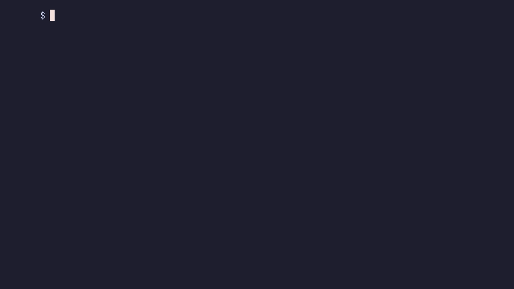

# Films

pfx-film renders scripted films offline from any app, at a fixed frame rate, frame by frame and sample by sample. A film is a TOML script of scenes. The app shows each scene through the `Show` trait; the film adds the camera, the looks, captions, marks and a synthesised score on top, then hands every frame and the mixed audio to an `Encoder`. A game uses it for its trailers and store clips, cut from the game's own frames.

It depends on `pfx-core`, `pfx-gpu`, `pfx-live`, `pfx-post`, `pfx-sound`, `pfx-text` and `pfx-input` (without default features), plus `serde`, `serde_json`, `toml`, `png`, `pollster` and `swash`; its `video` feature adds [pito-codecs](https://github.com/gmrdad82/pito-codecs) v1.16.3 for the footage films' clips. It runs no encoder or other tool itself: the default `Files` encoder writes PNG frames, PNG stills and a WAV under the folder the caller gives, and the caller turns them into a video with whatever it likes.

## What it does

- **The timeline:** scenes with lengths, cut or joined by a dissolve, push or whip, keys eased between (any pfx ease by name, or `step` to hold), speed ramps and freeze frames (`speed`), and a shake through pfx-core's `Shake`.
- **The camera:** focus, zoom, roll, follow and shake as a flat `View` matrix, kept inside the film's layout in any output aspect, with `Camera::lens` for an app's 3D camera and `safe` margins for a platform's interface.
- **The looks:** grade, desaturation and tint, contrast, a split tone, dim, vignette, grain, split, scanlines, curvature, bloom, letterbox, flashes and dips to black, as pfx-live look passes: one look for the app's picture (`game_look`), one over the overlay (`over_look`).
- **Captions:** text with named styles, outlines, slams, slides, growth and letter spacing that spreads, set letter by letter on the app's sheet.
- **Art:** rules, bands, glows, shades, spots and SVG marks with a label and a check badge; the app adds its own kinds.
- **The score:** recipes of tones and noise with envelopes, bends, filter sweeps and drive on pfx-sound's mixer, cued from the script and mixed under the app's audio, which follows the speed ramps (pitched and muffled when slowed).
- **The beat grid:** a tempo, a time signature and a tempo map, so every time in the script may be written in beats and bars, with a check that cuts and cues land on the grid.
- **Ducking:** the app's audio and any named bed sounds duck under the score, a sidechain compressor keyed by the score's envelope, set per film and per scene.
- **The writer and the plan:** `shoot` runs the film; `plan` gives each scene's frame count and the moment the app starts it from, every cut placed on the film's exact clock.

## The traits an app implements

```rust
pub trait Kinds {
    type Scene;
    type Film;
    type Art;
    type Drawn: Drawn;
    const ART: &'static [&'static str];
    fn check_film(film: &Self::Film) -> Result<(), String>;
    fn check_scene(scene: &Scene<Self>) -> Result<(), String>;
    fn check_art(art: &Art<Self::Art>) -> Result<(), String>;
    fn check_script(script: &Script<Self>) -> Result<(), String>;
    fn shown(scene: &Scene<Self>) -> bool;
}

pub trait Show {
    type Kinds: Kinds;
    type Cue: Cue;
    fn plan(&mut self, script: &Script<Self::Kinds>) -> Result<Vec<Self::Cue>, String>;
    fn set_theme(&mut self, scheme: Option<Scheme>);
    fn seek(&mut self, scene: &Scene<Self::Kinds>, take: &Take<Self::Cue>) -> Result<(), String>;
    fn aim(&self, scene: &Scene<Self::Kinds>) -> Option<[f32; 2]>;
    fn tick(&mut self, frame: u64, input: &[InputEvent]);
    fn draw(&mut self, frame: &FilmFrame<'_, Drawing<Self>>) -> Result<(), String>;
    fn audio(&mut self, out: &mut Vec<f32>);
    fn readback(&mut self) -> Result<Vec<u8>, String>;
    fn ticks(&self) -> u64;
    fn finish(&mut self) -> Result<(), String>;
}

pub trait Sheet {
    type Drawn: Drawn;
    fn size(&self) -> [f32; 2];
    fn draws(&mut self) -> &mut Vec<Draw>;
    fn group(&mut self, opacity: f32) -> Option<u16>;
    fn letter(&mut self, letter: Letter);
    fn width(&mut self, text: &str, size: f32, weight: u16) -> f32;
    fn check(&self, centre: [f32; 2], height: f32) -> Option<Draw>;
    fn art(&mut self, art: &Self::Drawn);
}
```

- `Kinds` names the app's own script keys: its `[[scene]]` keys, its `[film]` keys and its art kinds (listed in `ART`), with checks for each. Every `check_*` and `shown` has a default, as do `Show::ticks` and `Show::finish`.
- `Show` is the app. Each film frame the film asks `aim` (where `follow` should look), passes that frame's input to `tick`, cuts the frame and calls `draw`. The app advances by `frame.seconds()` of its own time, draws its picture under `frame.view(out)` and `frame.game_look(out)`, paints `frame.cut.pieces` with an `Overlay` on its sheet, composites the sheet under `frame.over_look(out)`, and gives back what it heard in `audio`. `readback` returns the frame as RGBA8 at the rig's size.
- `Sheet` is the app's overlay surface: flat draws plus letters in its own type. `check` draws the tick inside the check badge's disc.
- `Cast` fills a caption's `{slots}` and poses the app's art; `Sounds` is the score (`Score`, or an app's wrapper with sounds of its own); `Encoder` takes the frames, the stills and the audio (`Files` writes them to disk).

## A minimal film

```toml
[film]
bars = 2.39
glow = 0.4
seed = 3

[style.title]
size = 96
weight = 800
caps = true
outline = 4
smash = 0.5

[[scene]]
name = "open"
seconds = 2.0

[[scene.key]]
at = 0.0
zoom = 1.0
black = 1.0

[[scene.key]]
at = 1.5
ease = "cubic_out"
zoom = 1.4
black = 0.0
speed = 0.25

[[scene.text]]
text = "A {thing}"
style = "title"
at = 0.5

[[scene.sound]]
at = 0.0
sound = "pad"
```

Shooting it:

```rust
let score = Score::new(&score_toml, &[], 1, RATE)?;
let sounds = |name: &str| score.knows(name);
let known = Known { sounds: &sounds, marks: &["mark.svg"] };
let script: Script<MyKinds> = Script::parse(&film_toml, &known)?;

let mut score = Score::new(&score_toml, &[], script.film.seed, RATE)?;
let mut files = Files::open(&out, script.film.frames, script.stills() > 0)?;
let rig = Rig { size: [1920, 1080], fps: Rate::whole(60) };
let crew = Crew { show: &mut app, cast: &my_cast, score: &mut score, encoder: Some(&mut files) };
let reeled = shoot(&script, rig, crew)?;
```

`reeled` counts the frames, the app's ticks, the stills and the audio frames written. `plan(&mut app, &script, fps)` gives the takes without shooting.

## The layout

Every place in a script (a caption's `place`, a key's `focus`, an art's `place`) is a point in the film's layout, 1920x1080 unless `[film] layout = [width, height]` says otherwise (each side in [16, 16384]). The camera keeps its view inside that layout in any output aspect; a rig whose shape differs from the layout's (a portrait rig under a wide layout, or the other way) turns the layout for the overlay, so captions and bands fit the frame; a layout already the rig's shape stays as it is. `WIDE` is the default, and `Camera::wide` carries the layout to `picture_in`, `view`, `lens` and the looks.

## The finish

A film can give the app's picture a screen's finish: scanlines, a curved glass, luminance-weighted grain, a glow that takes only bright accents, and a split tone. They are `[film]` keys, the same for the whole film, built on the flat look's own passes (pfx-live `Crt`, `Grain`, `Bloom` and `Grade`); none is on by default, and a film that leaves them out renders the same bytes as one without them.

```toml
[film]
grain = 0.3
glow = 0.4
scanlines = 0.06
scanline_period = 2.25
curvature = 0.02
grain_response = 0.7
glow_threshold = 0.55
tone = 0.35
tone_shadow = "#4a6fd0"
tone_highlight = "#ffc489"
tone_range = [0.15, 0.85]
```

| Key | Range | Default | What it does |
|---|---|---|---|
| `scanlines` | [0, 1] | 0 (none) | the scanlines' strength on the picture: a row's light is scaled by `1 - strength * (0.5 + 0.5 * cos(2π y / period))`, so the darkest row of each period loses `strength` of its light and the row half a period on keeps all of it; 0.03 to 0.10 reads as a soft screen |
| `scanline_period` | [1, 64] | 3 | the lines' period in layout px; a rig turned against the layout scales it as it does grain, so the lines keep their size on the frame; 2.25 gives a fine weave, a whole number of output pixels gives even lines (a period of exactly 2 output pixels samples every row at the same phase and reads as a flat dim) |
| `curvature` | [0, 0.25] | 0 (flat) | bends the picture like a curved screen; what falls outside the glass is black; 0 to 0.035 is a gentle tube |
| `grain_response` | [0, 1] | 0.5 | weights the film's `grain` by luminance: a pixel of luminance `l` takes `1 - grain_response * l` of the grain, so dark ink and dim regions keep the full grain and bright regions lose `grain_response` of it; at 1 a white pixel takes none; 0.6 to 0.75 keeps highlights clean while the shadows stay grainy |
| `glow_threshold` | [0, 1] | 0 (all) | the luminance the `glow` starts above: each glowing draw's light is scaled by `max(l - threshold, 0) / l` before it is blurred, so only bright accents bloom and a draw at or under it adds nothing |
| `tone` | [0, 1] | 0 (none) | the split tone's amount |
| `tone_shadow`, `tone_highlight` | `#rrggbb` | `#ffffff` | the tints shadows and highlights lean to |
| `tone_range` | low < high, in [0, 1] | [0, 1] | the luminances where the tone is all shadow tint (at or under low) and all highlight tint (at or over high) |

The split tone is the flat Grade's `SplitTone`, the same curve as the 3D chain's luma-curve Warmth: `t = smoothstep(low, high, l)` on the pixel's luminance, and each channel is scaled by `mix(shadow, highlight, t)`, where a tint's multiplier is `1 - tone + tone * tint` brought into the picture's space as the key `tint` is. A pixel at the middle of the range takes the mean of the two multipliers, so a midtone moves by at most the larger of the two multipliers' distances from 1, and with tints balanced about neutral (as in the example) it stays close to neutral. It runs after the desaturation and contrast and before `dim`, the vignette and the grain.

Bad values are refused in one line that names the key, for example `[film] scanlines is a strength in [0, 1], 0 for none` or `[film] tone_shadow: "blue" is not a #rrggbb colour`.

## Marks and the check badge

`Marks::load(base, &[(name, svg)])` reads each SVG as it is drawn, through pfx-live's `svg::read_mark`, into flat draws and icons from icon id `base` on; the app bakes `marks.shapes` into its icon atlas. A mark keeps:

- **Fills:** `#rgb`, `#rrggbb`, `rgb()`, `rgba()` and the names black, white, red, green, blue and transparent; `currentColor` and a missing `fill` paint white (or the art's `colour`); `fill-opacity`; `fill-rule` (`nonzero`, the default, or `evenodd`), resolved into clean outlines with holes.
- **Gradients:** `linearGradient` and `radialGradient` (centre and radius; a focal point is ignored) with up to 8 stops and `stop-opacity`, in `objectBoundingBox` or `userSpaceOnUse` units, with `gradientTransform` and `href` to another gradient's stops. A rotated or skewed radial gradient keeps its axis lengths, not its tilt.
- **Strokes:** a colour or a gradient, `stroke-width`, `stroke-linejoin` (`miter`, the default, `round` or `bevel`), `stroke-miterlimit` (default 4), `stroke-linecap` (`butt`, the default, `round` or `square`), `stroke-dasharray` and `stroke-opacity`. A stroke is turned into its outline by [i_overlay](https://github.com/iShape-Rust/iOverlay) 9.0.0's stroker (MIT, already the workspace's polygon library), so joins and caps are exact and a stroke paints like a fill.
- **Shapes and groups:** `path`, `rect` (with `rx`), `circle`, `ellipse`, `line`, `polyline`, `polygon` and `use`; `transform` on any element; `opacity` on an element; a group's `opacity` multiplies into each shape in it (shapes that overlap inside one translucent group show through each other, as they would without the group).
- **Filters:** `filter="url(#id)"` on a shape or a group, for glows and drop shadows: `feGaussianBlur`, `feOffset`, `feMerge` with `feMergeNode`, `feFlood`, `feComposite` (`over`, `in`, `out`, `atop`, `xor`, `arithmetic`), `feBlend` in `normal` mode, `feColorMatrix` (`matrix`, `saturate`, `hueRotate`, `luminanceToAlpha`) and `feDropShadow`, with `in`, `in2` and `result`, `SourceGraphic` and `SourceAlpha`, the filter region (`x`, `y`, `width`, `height`, `filterUnits`, `primitiveUnits`), primitive subregions and `color-interpolation-filters`. Deviations and offsets are in user units. A filtered shape becomes an image in the film's atlas, rasterised on the CPU at the largest size the film shows that mark (its `size` times the peak of `grow` and `smash`, in the frame's own pixels, at most 4096 pixels a side), so it stays crisp at 4K; `Marks::rasters` paints them and `Marks::place` points the draws at their atlas slots. Any other primitive is refused in one line that names it, and a filter inside a filtered group is refused. A filtered shape keeps its colours under the art's `colour` and draws no `outline`.

The art's `colour` tints every shape of the mark one colour; without it the mark keeps its own colours. Its `outline` rings every shape in the `edge` colour; `outline = 0` draws none. A mark art draws one with an optional `label` and, with `check = true`, a check badge: a disc with the sheet's tick and a word beside it. The word and the disc's colour are the app's, set once on the marks:

```rust
let marks = Marks::load(0, &files)?.with_check(Check { word: "Approved".into(), colour: Srgba::hex(0x2f8f4f) });
```

`Check::default()` is the word "Checked" on a mid green.

## Sound cues and bands

A `[[scene.sound]]` cue plays one of the score's recipes:

| Key | What |
|---|---|
| `at` | seconds into the scene, in [0, the scene's length) |
| `sound` | the recipe's name in the score |
| `gain` | a linear gain on the recipe, in [0, 4]; default 1 |
| `pitch` | a transposition in semitones, within 24 either way; default 0 (every tone's frequency times 2^(pitch/12)) |
| `seconds` | the recipe's length stretched or shortened to this many seconds, in (0, 60]; default the recipe's own |
| `every`, `until` | repeat every so many seconds (at least 0.02, at most 400 repeats) until `until` or the scene's end |
| `accel` | with `every`, each gap is the last one times `accel` (in [0.2, 2], default 1): below 1 the repeats speed up, above 1 they slow down |

### Samples in the score

A score recipe's layer is a synthesised tone or noise (`wave`) or a recorded sample (`sample`), one of the two. A sample layer plays a WAV the score names, relative to the score's folder (`Score::in_dir(text, bare, seed, rate, dir)`; `Score::new` reads paths as given), so drums, hits, risers and an engine ride the same cues, the beat grid, the ducking, the sidechains and the limiters as the synth voices:

```toml
[recipe.kick]
kind = "kick"
length = 470

[[recipe.kick.layer]]
sample = "kick.wav"
volume = 1.0
pitch = -2
start = 3
end = 180
release = 20
```

| Key | What |
|---|---|
| `sample` | the WAV, 8-bit, 16-bit or float, any rate and channel count: converted to the score's rate once, when the score opens (linearly, as pfx-sound's `Clip::for_rate` does; a 48 kHz file is taken as it is), and played in stereo (a mono file on both sides) |
| `volume` | a linear gain, in [0, 4]; times the cue's `gain` |
| `pitch` | semitones within 24 either way, plus `cents`, plus the cue's `pitch`: the sample is resampled (pfx-sound's sinc, so it plays faster and higher, or slower and lower) |
| `start`, `end` | milliseconds into the file it plays between; default its whole length |
| `attack`, `release` | a linear fade in from the start and out before the end, in the sample's own milliseconds |
| `at`, `pan` | as on a tone layer: milliseconds into the recipe (stretched with the cue's `seconds`) and -1 to 1 |

- **On the grid, to the sample.** A sample starts on the frame its cue lands on, `round(time × 48000)`, the same frame a tone would start on; a cue on every beat at 128 bpm puts every hit 22,500 frames after the one before, with nothing before it (the test checks the first frame of each of 16 hits is the WAV's first sample, unpitched, pitched up and down, trimmed and from a 44.1 kHz file; an `attack` fade starts at gain 0 on that frame).
- **The same sends.** A sample layer plays on its recipe's channel, so the recipe's `lowpass`, `highpass` and `drive` sweeps shape it, and on its recipe's stem, so `[duck]` and `[duck.<name>]` key on it or duck it by the recipe's name or `kind`: a dialogue line as a sample with `kind = "dialogue"` ducks the beds under it.
- A sample layer refuses the tone's keys (`hz`, `note`, `decay`, `sustain`, `hold`, `bend`, `glide`, `linear`), a tone refuses `start` and `end`, a file that is missing or no WAV is refused with its path when the score opens, and so is a `start` past the file's end.

A `band` art is a horizontal strip across the whole layout, centred on its `place`'s height:

| Key | What |
|---|---|
| `height` | the strip's height in layout units; default 120 |
| `soft` | how far its top and bottom edges fade out, in layout units, in [0, 600]; default 0 (hard edges) |
| `colour` | `#rrggbb`; default black |
| `alpha` | its opacity, multiplied into the colour; default 1 |

## Input

A scene's `[[scene.input]]` touches drive the app at given times: `pointer = [x, y]` in the layout, `click = true` for a left click, and `key` for a press and release. A key is any pfx-input `Key`, named by its variant without regard to case or underscores (`enter`, `space`, `a`, `f5`, `page_up`, `numpad_1`), or a digit `0` to `9`.

## Beat grid

A film cut to music sets its tempo in `[film]`:

```toml
[film]
bpm = 128
signature = [4, 4]
offset = 0.5
snap = "1/4"
strict = false

[[film.tempo]]
at = "16bar"
bpm = 140
```

- `bpm` is the tempo from beat 1, in [10, 1000]. `offset` is the seconds from the film's start to beat 1 (0 by default); the time before it is the lead-in.
- `signature = [beats, note]` sets the bar (`[4, 4]` by default); `beats_per_bar = n` says the same in one number, and a script uses one or the other. A beat is what `bpm` counts.
- `[[film.tempo]]` changes the tempo from a place: `at` is film seconds (a number) or a place counted from beat 1 (`"16bar"` is where the seventeenth bar starts). Each change comes after the one before it, at most 256.
- With `bpm` set, every time in the script may be a string of beats and bars instead of seconds: a scene's `seconds` and `from`, its transition's `seconds`, a key's, text's, art's, sound's, flash's, shake's and touch's `at` and `until`, a text's and art's `fade` and `out`, a sound's `every` and `seconds`, a flash's `seconds`, and a style's `fade` and `out`. Write `"8b"`, `"1.5b"`, `"2bar"` or `"2bar+1b"` (`b`, `beat`, `beats`, `bar`, `bars`, joined by `+`). A number is still seconds.
- Each is turned into seconds once, at parse, through the tempo map: a scene's length from where the scene starts, a cue's `at` and `until` from the scene's start, a length on a cue (`fade`, `every`, …) from the cue's `at`, and a style's from the first tempo. Within one tempo it is `beats × 60 / bpm` in a single division, so `"8b"` is exactly 4.8 s at 100 bpm and 3.75 s at 128, and `frames()` gives 288 and 225 frames at 60 fps. Without `bpm` a string time is refused.

### The snap check

`Script::off_grid(fps)` lists what misses the grid at that fps: a scene whose length isn't a whole number of `snap` subdivisions (of beats with `snap = "off"`) by more than one frame, a cut (counted in whole frames, as the film shoots it) or a transition's end more than half a frame off the `snap` subdivision, and a key, flash, shake, text or sound cue's `at` more than one frame off it. `snap` is `"1"`, `"1/2"`, `"1/4"` (the default) up to `"1/64"` of a beat, or `"off"` to check lengths only. Anything in the lead-in isn't checked. Each line names the scene and the time in beats, from the scene's start and from beat 1:

```text
scene 'drop': a key at 1.4b is off the 1/4-beat grid by 3.0 frames (1.4b from beat 1)
```

It only warns: `off_grid` returns the lines for the app to print, and `pfx film --plan` prints them after the plan as `off grid: …` lines (with `--json`, as an `off_grid` list). With `strict = true` it refuses with the first line, and `plan` (so `shoot` and `--plan`) refuses with it too.

### Exact cuts

The film keeps one clock. Frame n is at exactly n × den / num seconds of the film's rate (`Rate::time`), computed from n alone, never by adding steps. Each scene starts at its exact time in seconds, the sum of the lengths before it, and its cut is the frame nearest that time, `round(start × num / den)` from the film's start (`Script::cuts`); a scene's frames are the gap between its cut and the next. So no cut is ever more than half a frame from its time, and the error never adds up: at 128 bpm and 30 fps a beat is 14.0625 frames, and a run of half- and quarter-beat scenes that summed each scene's own rounded length would drift later with every quarter beat (4 frames for 3.52), while the film's total stays `round(seconds × fps)`. Inside a scene the picture's time is the film frame's time less the scene's start (never below 0), so keys, fades, transitions, speed ramps and the beat grid's checks all read the same rational clock, so a key, a caption, a flash, a shake or a touch lands on the frame where the film reaches its time, the same clock the score's cues and the ducking laws are placed on in samples.

## Transitions

A scene cuts in by default. `[scene.transition]` joins it to the scene before instead:

```toml
[[scene]]
name = "drop"
seconds = "4bar"

[scene.transition]
kind = "dissolve"
seconds = "1b"
```

| Key | What |
|---|---|
| `kind` | `dissolve` (a crossfade), `push` (the outgoing scene slides out as this one slides in behind it) or `whip` (a push on a fast ease, smeared along the move) |
| `seconds` | its length, in seconds or beats, in (0, the scene's length] |
| `towards` | for `push` and `whip`, the way the pictures move: `left` (the default), `right`, `up` or `down` |
| `ease` | any pfx ease by name; `linear` for a dissolve, `sine_in_out` for a push and `expo_in_out` for a whip by default |

- **Where it sits:** the transition starts on the scene's cut, which stays where it was (the incoming scene's first frame, its keys and its cues are timed from it), and ends `seconds` later, on the film's clock like a cut, so the film's length and every cut are what they were without it. The snap check names a transition whose end is more than half a frame off the grid. The first scene can't have one.
- **Both scenes run through it:** after the outgoing scene's last frame, the film goes on drawing it for the transition's frames (the app keeps ticking it at its speed; its captions, art and looks hold as they were on its last frame) and keeps those pictures; then the incoming scene starts on its cut, and each of its first frames is mixed with the outgoing picture of the same film frame. The mix at film time t is `w = (t − start) / seconds` through the ease: a dissolve is `outgoing × (1 − w) + incoming × w` per 8-bit channel, rounded, so its middle frame is the even mix of the two; a push moves both pictures by `w` of the frame's width (or height); a whip also smears each line along the move by the distance it moved since the frame before, a box over that many pixels, its motion blur.
- **Sound:** the score is unaffected. The outgoing scene's own audio stops at the cut, as it does without a transition; the incoming scene's plays from its cut.
- **Cost:** the outgoing pictures are kept in memory for the length of the transition: at 1080p one frame is 8 MB, at 2160x3840 33 MB, so a one-beat dissolve at 120 bpm and 60 fps holds 30 frames (250 MB or 1 GB). The mix is one pass over the frame on the CPU; a whip's smear is a running sum per line. A film shot without frames (only stills, or no encoder) draws no transitions.
- The app's `Show` sees the outgoing scene's extra frames as more `tick`s and `draw`s after the scene's last one, with no input, before the next `seek`.

## Ducking

A `[duck]` table ducks the bed under the score:

```toml
[duck]
under = ["score"]
beds = ["crowd"]
depth_db = 12
attack = 10
release = 250
threshold_db = -30
knee = 6
lookahead = 5

[[scene]]
name = "quiet"
seconds = "4bar"

[scene.duck]
depth_db = 0
```

- **The bed** is what ducks: the app's own audio (what `Show::audio` returns, after the speed ramp) and every sound named in `beds`, the app's samples and stems included.
- **The key** is what it ducks under: `under` (a name or a list) is `"score"` for every score sound not in `beds`, or names score sounds and cue kinds. A recipe in the score names its kind with `kind = "hit"` (braams, hits and the like); a score sound neither keyed nor a bed plays dry, beside both.
- **The law:** `depth_db` is the most the bed drops, in [0, 60]; `threshold_db` (in [-90, 0]) and `knee` (dB in [0, 24]) set where it starts; `attack` and `release` are milliseconds; `lookahead` (ms, in [0, 100]) reads the key that much ahead, so the bed starts down before a hit lands, with nothing delayed. The defaults are 12 dB, 10 ms, 250 ms, -30 dB, 6 dB and 5 ms.
- **Per scene:** `[scene.duck]` overrides any of the law's six fields from that scene's start; `depth_db = 0` turns ducking off there (the bed comes back over the release). A scene override without a `[duck]` table ducks only in those scenes, under the whole score.
- **How:** the key's level is the louder of its two channels, in dB; a soft-knee gain computer gives how far it is over the threshold, capped at `depth_db`; an envelope follower smooths that with the attack and release; the bed is multiplied by the resulting gain. The mixdown keeps the bed, the key and the dry sounds apart while the film is shot and ducks the bed once at the end, before the soft limiter, so it is offline, sample exact and deterministic. It costs about 27 ms per minute of film audio on one core.
- **Routing:** the `Sounds` trait's `route(under, beds)` and `render_apart(frames)` (key, bed, dry) split the score; their defaults put everything on the key. `Score` routes by name and kind, refuses an `under` that is no sound or kind, and plays the bed and the dry sounds on mixers of their own, made only when a script asks for them. An app's own `Sounds` wrapper routes its samples the same way.
- A film without `[duck]` or `[scene.duck]` mixes exactly as before, byte for byte.

### The bed

`[film] bed` lays a recorded WAV under the whole film, a music bed or a room tone, mixed before the ducking and the limiters:

```toml
[film]
bed = { file = "bed.wav", gain = 0.8, from = 12.5 }
```

- `file` is the WAV, relative to the script's folder (pfx-film reads it when `Script::read_bed(dir)` is called; `pfx film` calls it with the script's folder, and a film whose bed was not read is refused when it is shot); any rate and channel count, converted to 48 kHz stereo once. `gain` is linear, in [0, 4] (1 by default); `from` is the seconds into the file the film's first frame plays (0 by default). The bed starts with the film and stops at the file's end or the film's.
- It plays on the bed bus, beside the app's audio and the score's `beds`: with `[duck]` it ducks under the key exactly as a score sound named in `beds` does (the test mixes the same WAV both ways and finds them within 1e-6), without `[duck]` it plays dry; either way it goes through `[film] limit`, `ceiling` and `true_peak` with the rest. Unlike the app's audio it never follows a scene's speed ramp: it is the film's own track.

### Sidechains inside the score

`[duck.<name>]` ducks score sounds under other score sounds, the bass under the kick, several at once:

```toml
[duck.bass]
under = ["kick"]
beds = ["bass", "sub"]
depth_db = 12
attack = 2
release = 40
lookahead = 2

[duck.pads]
under = ["kick", "braam"]
beds = ["pad"]
depth_db = 6
```

- `under` and `beds` each name score sounds or cue kinds (`kind = "kick"` on a recipe), each once and never in both; `under = ["score"]` keys on every score sound that isn't one of its beds. A name the score has neither as a sound nor a kind is refused when the film is shot.
- The law is the same six fields with the same defaults, one law for the whole film. The sidechains run in name order, each keyed by the stems as the ones before it left them, so a bed of one can be the key of the next.
- `[duck]`'s own keys still duck the app's audio under the score. A `[duck]` table holding only named sidechains leaves the app's audio alone; with its own keys, or empty, it ducks the app too, after the sidechains.
- **How:** `Score::stems` puts every score sound that a sidechain names on a stem of its own (one pfx-sound mixer for each set of sidechains a sound belongs to, made only for such a film); the mixdown keeps each stem apart and ducks the beds at the end, with the same follower and gain computer. The `Sounds` trait's `stems(selectors)` and `render_stems(frames)` are the hooks; their defaults refuse named sidechains, so an app's own `Sounds` wrapper overrides both to take part.

## The drop and the limiters

A drop hits when it is louder than the build. Two things set that:

- **The score's gain by scene:** `[scene.score] gain_db = -6` (in [-60, 12]) scales every score cue that starts in that scene, so a build written at the drop's levels sits 6 dB under it. It applies to cues by where they start: a sound cued in the build keeps the build's gain as it rings into the drop.
- **The limiters don't flatten it.** The score's mixer soft-clips each sample above the score table's `limiter` and clamps at full scale, and the film's master soft-clips each sample above `[film] limit` (0.72 by default) with a tanh, then scales the whole film down at once if its peak is over `[film] ceiling` (0.89 by default, in (0.1, 1]). The last is one gain for the whole film, so it keeps the build's and the drop's levels apart; the clips touch only peaks. In the test fixture, at 128 bpm, the build and the drop sit at -15.8 and -14.7 dB RMS as written, -21.8 and -14.7 with the build at `gain_db = -6`, and a drop pushed until it limits loses 0.1 dB of its lead to the clips. Raise `limit` and `ceiling` towards 1 for more headroom.

- **The true-peak ceiling.** Last, the master is held under `[film] true_peak` (in dBTP, in [-20, 0], -1.0 by default) as ITU-R BS.1770-4 measures true peak: each channel oversampled 4x through the recommendation's 48-tap polyphase filter (Annex 2), the peak between samples as well as on them. A master already under it is left exactly as it was. One over it goes through pfx-sound's `Limiter`, a lookahead limiter linked across both channels: each sample's gain is what brings its true peak to the ceiling, held as a moving minimum over the attack and hold (5 ms each), released over 80 ms and smoothed by a box over the attack, with the audio read 5 ms ahead so the gain is down before the peak. The limited master is measured again (up to four passes) and scaled by the rest if any true peak is still over, so no oversampled point ends above the ceiling. The sample peak `ceiling` scale alone leaves the peaks between samples: the test fixture's drop with `limit = 0.99`, `ceiling = 1.0` and its kick at gain 2 to 4 measured -0.02 to +0.13 dBTP, sample peaks 0.994 to 0.997; with the limiter it masters at -1.0 dBTP.

A film that sets neither `[scene.score]`, `limit` nor `ceiling` mixes exactly as before, up to the true-peak ceiling: the default -1.0 dBTP changes a film's audio only where the old master went over it (the test fixture's did, by 0.006 dB, and its pinned hash moved with it). Masters are measured in about 0.28 s for three minutes of stereo audio, and a hot one limited in about 1 s (release build, one core).

## Determinism

pfx-film never reads the wall clock or a global random source. The film's time is the frame index times den over num, the shake runs from a fixed seed, the score's noise from the seed the app gives `Score::new` (the script's `seed`), and the app gets its time only from `frame.seconds()`. So the same script, revision, seed and app give the same frames, stills and samples byte for byte; the crate's test renders a film twice and compares every byte.

## The audio contract

- The film's audio is 48 kHz (`RATE`) stereo (`CHANNELS`, interleaved left and right) in `f32` samples.
- Each film frame the app hands back what it heard in that frame in the same format; the film resamples it by the frame's speed, so a slowed scene sounds pitched down and muffled; in a scene `Kinds::shown` hides, the app's audio is silent and the score plays on.
- The score and the `[film] bed` are mixed on top, then softly limited above `[film] limit` (0.72), scaled under `[film] ceiling` (0.89) and held under `[film] true_peak` (-1.0 dBTP). `Encoder::finish` gets the mixed samples with the rate and channel count; `Files` writes them as a 16-bit PCM WAV, `audio.wav`.
- A frame's audio starts `floor(frame × RATE × den / num)` samples in (`shoot::samples`, whole numbers throughout), and the frame plays up to the next frame's start. No per-frame count is ever rounded and added, so the audio cannot drift from the picture over any length of film. Rates that divide 48 kHz evenly give frames of equal length: 60, 30, 24 and 23.976 (24000/1001) all do, 23.976 at exactly 2002 samples a frame (the 2002.002 that 48000 / 23.976 suggests comes from the rounded decimal; the exact rate divides). 29.97 is 1601.6 samples a frame, so its frames run 1601, 1602, 1601, 1602, 1602 and repeat, 8008 samples every 5 frames, the cadence editors use for NTSC audio; 59.94 is 800.8, 4004 every 5 frames.

## Footage films

<p align="center"></p>

A film needs no game: `pfx_film::reel` is a built-in `Show` and `Kinds` whose scenes are footage, and `pfx film` assembles one from the command line.

```
pfx film <script.film.toml> --out <dir> [--memory-limit GB] [--json] [--plan]
```

`--out` is a folder under the caller's `tmp/`. The command writes `frames/000000.png...`, `stills/<name>.png` for scenes that name a still, `audio.wav` and `manifest.json`, and prints the manifest's path (or, with `--json`, the manifest itself). It never runs an encoder; the manifest's `pcod` field is the exact command that makes the video, `pcod frames <out>/frames --audio <out>/audio.wav --fps <fps> <out>/film.mp4`. `--plan` checks the script and its files and prints each scene's kind, length, start and frame count without rendering (with `--json`, as JSON; with `--out`, with the `pcod` command too).

A second run into the same `--out` resumes. `film.txt` there names what made the frames: the script's sha256, the pfx version, the size, fps and frame count, and each scene source's fingerprint (a file's length and modified time, or a folder's file list with theirs). When it matches, the film plays from the start as always (each frame depends on the ones before it: the cuts, the clips' decoders, the mix), and every frame already on disk that is a whole PNG of the film's size is kept instead of written again; when it doesn't, `frames/` is cleared and made afresh. A resumed run says `resuming: 37 of 120 frames done, starting at frame 37` on stderr. Every frame, `audio.wav`, `film.txt` and `manifest.json` is written to a hidden `.<name>.partial.<ext>`, synced and renamed, so a stop never leaves half a file; leftovers are swept at the next run. With `--json` stderr carries one JSON object a line: `{"stage":"resume","done","of","from"}` when resuming, and `{"stage":"frame","frame","of","elapsed_s","eta_s"}` at most once a second and at the last frame.

On a terminal, `pfx film` keeps a progress line on stderr (frame n/N, frames per second, ETA and a bar), cleared before it prints; piped, with `NO_COLOR` or with `--json` it shows none ([Progress and stderr](render-a-scene.md#progress-and-stderr)).

The manifest carries `film` (1), `script` and `script_sha256`, `frames`, `fps` (a whole number, or a ratio's value as a float), `frame_rate` (the exact rate as text, `60` or `24000/1001`, which the `pcod` command passes on), `size`, `seconds`, `scenes` (name, kind, seconds, from, frames, source), `out`, `frames_dir`, `stills_dir`, `stills`, `wav`, `samples`, `rate`, `format` (`png`), `pcod`, `pfx` (the version) and `wall_ms` (`total`, `per_frame`).

A footage script is a film script (everything above works: keys, camera moves, looks, captions, marks, flashes, shakes and the score) with these keys added:

| Key | Where | What |
|---|---|---|
| `size` | `[film]` | the output's width and height in pixels, even, in [16, 16384]; default `[1920, 1080]`; `[2160, 3840]` is a vertical 4K film |
| `fps` | `[film]` | the film's frame rate, from 1 to 240, default 60: a whole number, a ratio string such as `"24000/1001"`, or `23.976`, `29.97`, `47.952`, `59.94`, `119.88` (read as the exact NTSC ratios); any other decimal is refused naming the ratio to use |
| `score` | `[film]` | a score TOML (the recipes `[[scene.sound]]` cues), relative to the script; none means no score sounds (the film opens with an empty score) |
| `font` | `[film]` | the font captions, labels and the check word are set in, relative to the script; needed when the film has text; pfx ships none |
| `background` | `[film]` | the `#rrggbb` behind every scene that sets no backdrop; default black |
| `check`, `check_colour` | `[film]` | the check badge's word and disc colour; default "Checked" on a mid green |
| `dither` | `[film]` | true by default: the 8-bit frames are dithered where they are rounded, blue noise of about one level seeded by `[film] seed`, the same every frame ([the output dither](recipe-render.md#the-output-dither)); false rounds plainly |
| `kind` | `[[scene]]` | `clip`, `frames` or `card` (required) |
| `file` | clip | the video, relative to the script |
| `dir` | frames | the frame folder, relative to the script |
| `fit` | clip, frames | `fit` (the whole picture, bars of the backdrop around it; default) or `fill` (the layout covered, the picture cropped) |
| `volume` | clip, frames | the footage's gain, in [0, 4]; default 1 |
| `track` | clip | which audio track plays, 0 first; a clip with none is silent |
| `colour` or `gradient` | any scene | the backdrop: a `#rrggbb`, or `["#top", "#bottom"]` falling from top to bottom |
| `crop` | clip, frames | `[x, y, width, height]` in the source's pixels, cut before `fit` places it; the picture's own size when absent |

A scene's `from` is where in its footage it starts, in seconds. Paths may also be absolute. Set the film's `layout` to the output's shape (`[1080, 1920]` for a vertical film) so captions and marks are placed in it.

- **clip** plays a video from `from` for the scene's length, scaled to the layout by `fit`, with its audio as the scene's stem, resampled to 48 kHz stereo. Decoding goes through [pito-codecs](https://github.com/gmrdad82/pito-codecs) v1.16.3 (MIT, pinned by tag, behind pfx-film's `video` feature, which the `pfx` tool turns on): MP4, MOV, MKV and WebM in H.264, HEVC, VP9 or AV1, with AAC, Opus, AC-3, E-AC-3, MP1, MP2, MP3 or PCM audio, on the GPU (VA-API, VideoToolbox, Media Foundation) when it decodes the stream and on the CPU otherwise, bit-exact either way; no other program runs. A WebM or MKV whose VP9 carries alpha keeps it: the clip is read through pito-codecs' alpha decoder and its pictures carry that alpha into the layout. A phone recording's rotation is applied. A build without `video` refuses clip scenes when it opens the script.
- **frames** plays a folder of `000000.png`, `000001.png`... as `pfx shot` writes them (or a `frames/` folder inside it, as `pfx film` writes them), with its WAV. A `manifest.json` in the folder gives `frame_rate` (or `fps`), `frames` and `wav` (absolute or relative to the folder); without one the frames count up from `000000.png` at the film's fps and `audio.wav` beside them is the sound. 8-bit and 16-bit RGB, RGBA and grey PNGs read; PCM 8, 16, 24 and 32-bit and float WAVs read, mono or stereo, at any rate (resampled linearly to 48 kHz).
- **crop** keeps only its rectangle of each source frame, copied out of the decoded picture before it is uploaded, so nothing outside it bleeds in at the edges, and the cut picture is what `fit` or `fill` places. A crop that reaches past the picture is cut to it; one wholly outside it stops the film with an error.
- **image** art, `[[scene.art]] kind = "image"`, draws a PNG on any scene, over the footage with the captions: `file` (relative to the script), `place` (its centre), `width` and `height` in layout units (one of them keeps the image's aspect; neither draws it at one layout unit per pixel; both make a box it fits, or fills and crops with `fit = "fill"`), and the art's timing keys (`at`, `until`, `fade`, `out`, `grow`, `slide`). The film's images are packed when the script opens, tallest first, onto shelves (`reel::pack`, a port of etagere's shelf allocator) in atlas pages of 8192x8192, up to four, each cut to the part it uses, and drawn through the flat renderer's sprite path: the first page's images in the overlay's own pass, in their place among the other art, and a later page's in a pass of its own under the overlay. Each image is at most 8188x8188; 48 stills of 2160x1080 take three pages. One that is too big, or that the four pages can't hold, is refused in one line that names it. `radius` rounds its corners (layout units, at most half its shorter side; outside the arcs it is transparent), and `shadow = { offset = [x, y], blur = 8, alpha = 0.5 }` draws a black copy of its rounded box behind it, moved by `offset` (layout units), softened by a Gaussian of `blur` (layout units, in [0, 400]; 0 for a hard edge) and as opaque as `alpha` (0.5 by default): where it falls on the picture, each 8-bit channel is darkened by that share.
- **clip** art, `[[scene.art]] kind = "clip"`, plays a video picture-in-picture on any scene: `file` (relative to the script), `from` (seconds, or beats, into the video it starts at; 0 by default), and the image art's `place`, `width`, `height`, `fit`, `radius`, `shadow` and timing keys. It is decoded like a clip scene, through pito-codecs with the same decoder, at its own full resolution, one decoder per playing clip, and not packed into the atlas: each frame the film shows its source frame at `from` plus the time since the art appeared (its frame n shows `from + n / fps`, the source frame at or before that time), uploaded as its own texture when it changes and drawn in its own flat pass over the scene's picture and under the captions, the marks and the other art; the over look's flashes, dips and bars cover it. Its audio is not played. A build without the `video` feature refuses it when the script opens. A 1920x1080 H.264 clip art with rounded corners and a soft shadow on a 2160x3840, 60 fps card cost about 10 ms a frame more (62 ms against 50 to 55 ms, decode to readback, frames not written; release build under `pgpu run --class bench`, the machine loaded at about 35).
- **card** is the backdrop alone: a colour or a gradient, with the scene's `[[scene.text]]` lines in the film's `[style.*]` and `[[scene.art]]` marks on it. A mark's `file` is an SVG the film's author supplies, read relative to the script; the film ships no wordmark.

When a clip's or a folder's rate differs from the film's, each film frame shows the source frame at or before its time and nothing is blended: a 30 fps clip in a 60 fps film shows every frame twice, a 120 fps folder every other frame. The audio is never retimed; it plays at its own rate. A speed ramp (`speed` in a key) moves through the footage at that speed, and the film pitches its audio as it does a game's.

Each frame is drawn on the GPU through pfx-live's flat renderer: the footage frame as a sprite under the camera's view and the game look (grade, desaturation, contrast, split tone, dim, vignette, grain, split, scanlines, curvature), then the overlay (captions, marks, art) under the over look (glow, flashes, dips to black, letterbox), read back as RGBA8. Text is set with `pfx-text` in MSDF glyphs at the output's density, so captions stay crisp at 4K.

**Cost:** a 3-second vertical film at 2160x3840 and 60 fps (2 s of a 4K H.264 screen recording zoomed by the camera with a desaturation key, grain and a vignette, a caption with a 4-unit outline, then a 1 s card with a caption, a mark and a check badge, and a score cue), `pfx film` built in release under `pgpu run --class bench` with the card to itself, took 19.6 s for 180 frames: 109 ms a frame from decode to PNG on disk, the GPU 30% busy on average (an AMD Radeon RX 9060 XT on Mesa radeonsi). The work per frame is the decode and YUV to RGBA conversion on pito-codecs, the 33 MB sprite upload when the picture changes, two flat passes with their looks, one RGBA16 readback and the PNG writes on every core.

## Tests

`cargo test -p pfx-film` renders `crates/film/tests/fixtures/film.toml` twice through a neutral app and checks the frames, the still and the audio match byte for byte; checks the looks pfx-live accepts at every key's limits, every fixture sound, the marks' bake and the script's refusals, and pins the fixture film's hash on Linux and macOS (Windows' maths library gives other bits, so there a film repeats itself exactly but not across systems). `tests/beat.rs` converts beat times exactly at 100 and 128 bpm, through a signature and a tempo map, and names the scene and the beat of every off-grid time; it cuts 96 half- and quarter-beat scenes at 128 bpm and 30 fps and checks the film keeps `round(seconds × fps)` frames, every cut within half a frame of its time, no cut flagged, a cut more than half a frame off named, and a key in the last scene landing on the film's clock; the ducker's unit tests drop a bed by its depth under a hit, bring it back over the release and turn it off per scene, and the film test shoots the fixture ducked under the score, under a cue kind and off. `tests/transition.rs` shoots two flat scenes through a dissolve, a push and a whip on a test app whose picture counts its own frames, and checks the dissolve's middle frame is the even mix of both scenes (each at its own frame, so both ran through it), the cuts, the length and the audio are the same as without it, the push's halves, the whip's smear and the refusals. `tests/drop.rs` mixes a build and a drop from `fixtures/drop.toml` and measures that a hot score masters under its true-peak ceiling (the default, -1 and -3 dBTP), that `[scene.score] gain_db = -6` puts the build 7 dB under the drop and the limiters keep that lead, that a `[duck.bass]` sidechain drops the bass by its depth under each kick and brings it back before the next while the kick-less build stays bit for bit, and that sidechains naming what the score lacks are refused. `tests/samples.rs` writes its WAVs in the test (a 40 ms decaying 60 Hz kick at 48 and 44.1 kHz, a 220 Hz bed and a 330 Hz line; nothing is tracked) and checks a kick sample on every beat at 128 bpm after a quarter-second lead-in lands each of its 16 hits on its grid frame with only silence before it, plain, pitched up 7 and down 12 semitones, trimmed with a release and from the 44.1 kHz file (with an `attack` the hit starts on its frame at gain 0, so its first sound is the frame after), with the WAV's first sample on that frame and the same samples twice; that a hot sample at volume 4 over a bed at gain 2 and 4 masters under -1 and -3 dBTP; that the bed drops by the law's 12 dB under a dialogue sample keyed by its kind and comes back after the release, matches the same WAV played as a score sound in `beds` within 1e-6, plays dry without `[duck]`, and starts `from` its seconds in at its gain; and the refusals. The fixtures are neutral files written by hand, listed in `crates/film/tests/fixtures/README.md` and `tests/agnostic/fixtures.txt`. `tests/atlas.rs` packs 48 stills of 2160x1080 (with their gutters, a 2164-wide column 52,032 tall before) onto three pages with no overlap, packs 40 small stills that overflowed a 256-pixel column onto one 256x256 page and reads each back from its slot, names the image that doesn't fit, and its GPU test draws two 4100x4100 images that land on two pages. `tests/clip_art.rs` (`--features video -- --ignored`, under pgpu) generates a 30-frame H.264 clip of distinct greys, plays it as clip art from 0.2 s with rounded corners and a hard shadow, and an image art with a blurred shadow, and checks frame n of the art shows the source frame at `from + n / fps` as pito-codecs decodes it, the corners outside the arcs show the backdrop, and the shadows darken it by their alpha. `cargo test -p pfx-film --test reel` opens a footage script and checks its plan, frame counts, `pcod` command and refusals; its GPU test (`--features video -- --ignored`, under pgpu) generates a 15-frame H.264 and AAC clip with pito-codecs' own encoder, a 4-frame 15 fps PNG folder with a 24 kHz WAV and a manifest, a 4-frame cropped folder, and a card with a caption, a mark and a check badge, a gradient mark, a butt-capped stroked mark and a PNG image art, shoots the film twice and checks every frame and sample match, that the folder's frames are held across the 30 fps film, that the crop shows only its rectangle, that the gradient runs from its first colour to its last, that the stroke stops at its caps, and that the clip, the folder, the image and the card show and sound. pfx-live's `flat::svg` tests read a mark with a radial gradient, `fill-opacity` and butt and square caps, and check a board still keeps its SDF strokes.
