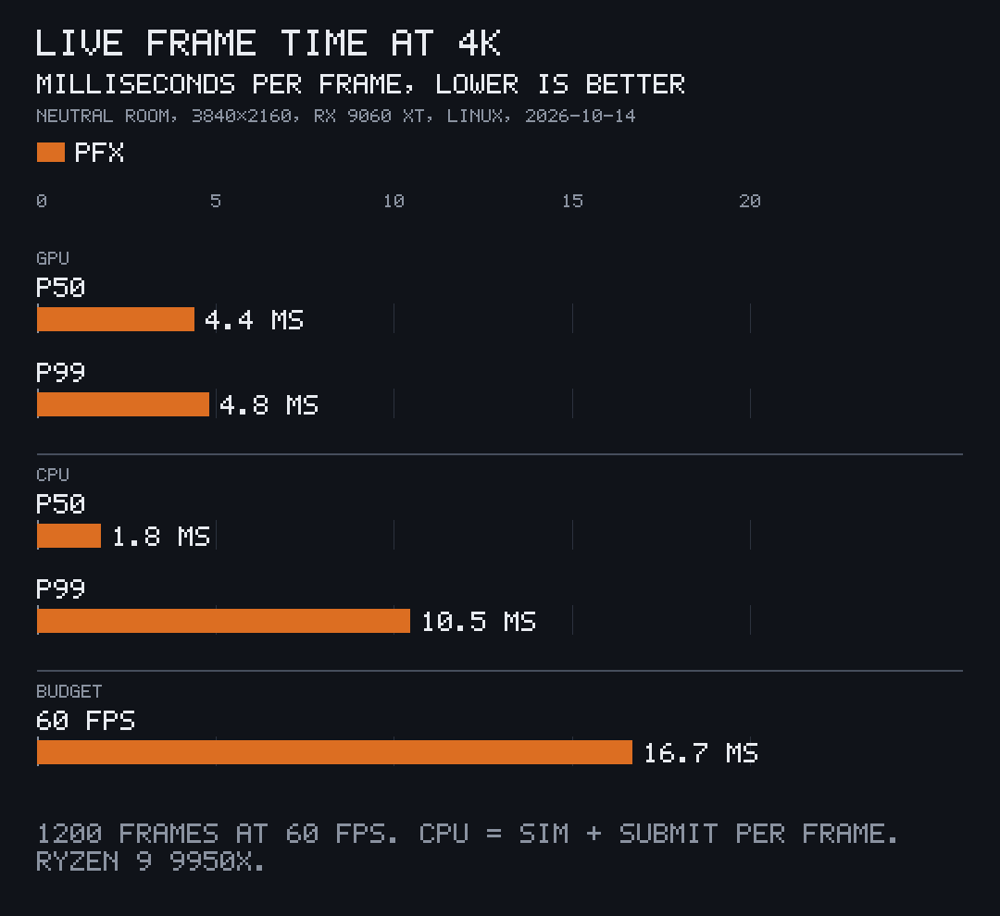
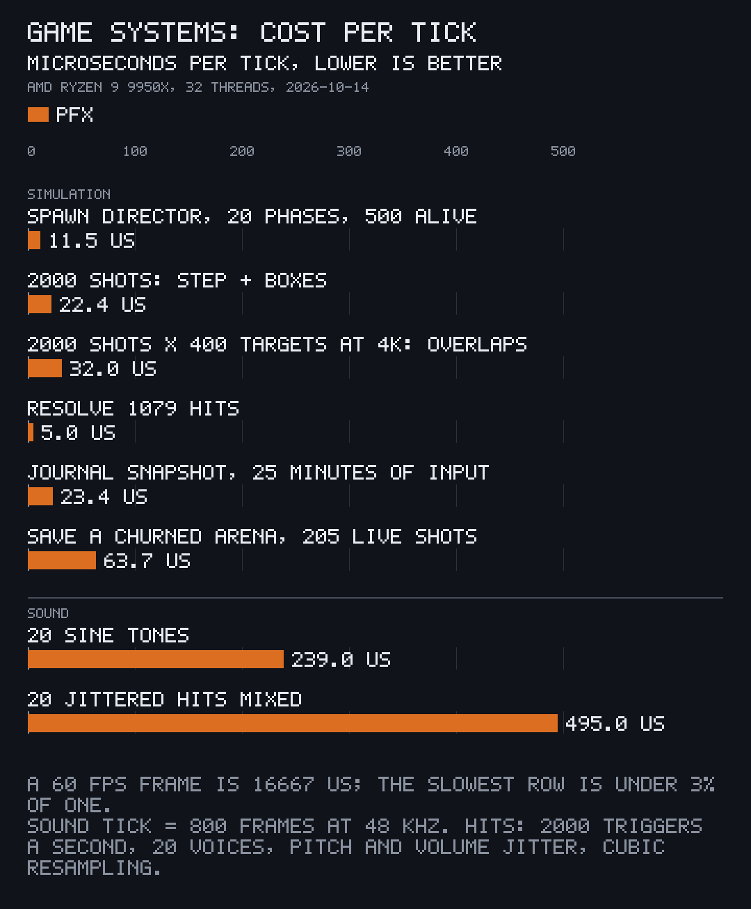
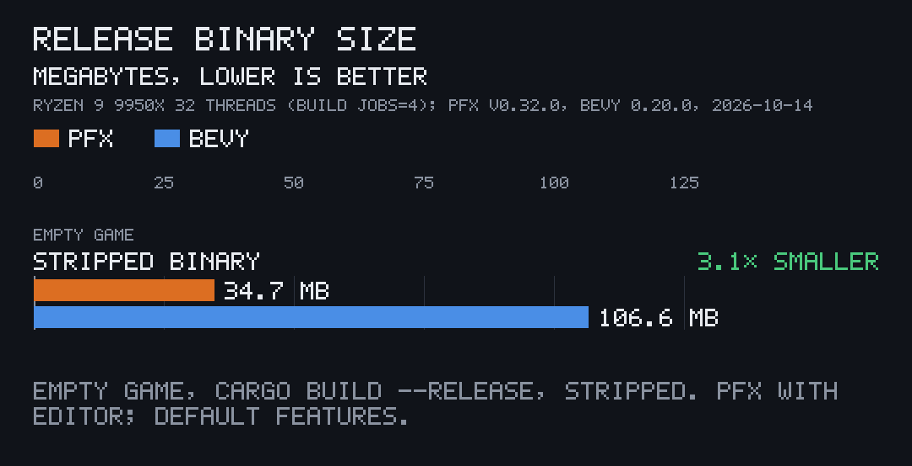
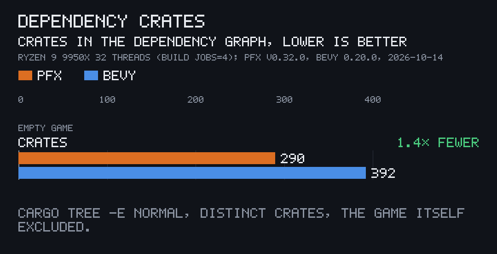
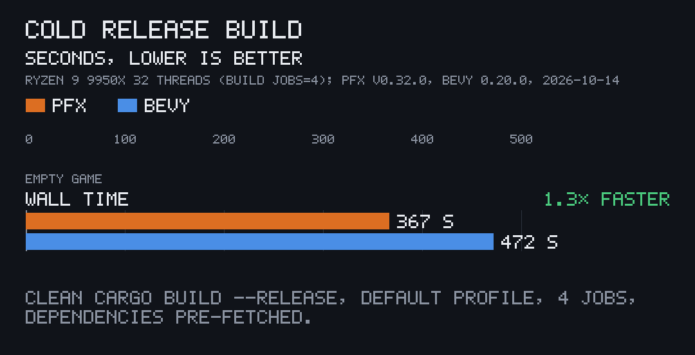

# Measured

The numbers the README quotes that have no page of their own, and how each was taken. The path tracer's are in [trace.md](trace.md#the-material-record), the denoiser's in [denoise.md](denoise.md#speed) and the `.pitofx` file's load times in [pfx-file.md](pfx-file.md#load-time).

All were measured on an AMD Radeon RX 9060 XT with an AMD Ryzen 9 9950X (32 threads) under Linux, each GPU run through the machine's GPU queue, which other jobs shared. The live and 2D numbers were measured on 2026-10-15 as an A/B against the commit before them (9e7514a): both release builds alternated run by run, five runs each, at a load average of 13 to 35, and each number is the median of the five. The rest were measured once on 2026-10-14 at commit 637c352 (v0.32.0).

## Live, 4K

`pfx bench crates/load/tests/scenes/room.scene.toml --seconds 20 --size 3840x2160`, the neutral room, 1,200 frames a run: GPU 4.4 ms a frame at p50 and p99, about a quarter of the 16.7 ms a 60 fps frame allows; the CPU's simulate-and-submit 0.85 ms at p50 and 1.7 ms at p99; no dropped frames. The same frame before: GPU 4.39 ms p50 and 4.41 ms p99, CPU 0.86 ms p50 and 1.84 ms p99; the room is GPU-bound with few instances, so the CPU savings in the frame's uploads and bind groups barely show here. The A/B ran twice, because its first CPU p99 (1.65 ms before, 1.83 ms after) was within the noise; these are the second run's.

## Frames on demand

`crates/live/examples/frames.rs`, the desk at 4K: every frame 4.9 ms GPU at the median, a drifting camera 0.50 ms, an idle scene 0 ([live-renderer.md](live-renderer.md)).

## 2D pass

The swarm test `a_swarm_of_shots_and_particles_fits_a_120_hz_frame_on_the_gpu_at_4k` in `crates/live/src/flat/effects/`, 2,000 shots and 20,301 particles at 4K: GPU p50 0.36 ms and p99 0.37 ms (0.42 and 0.43 before, the pick pass now drawn only when a pick waits), the `render_flat` call 3.10 ms on the CPU (3.41 before), of which `prepare` 2.46 ms.

## Game systems

The bench tests in pfx-core and pfx-sound (`cargo test --release -p pfx-core --features serde --lib -- --ignored bench_`, `cargo test --release -p pfx-sound --test bench -- --ignored`), one thread. A sound tick is 800 frames at 48 kHz, with cubic resampling, the default for short sounds.

## Size

An empty game made by `pfx new`, against an empty Bevy app with its default plugins, both built cold with `cargo build --release` on the same machine:

pfx v0.32.0's scaffold and Bevy 0.20.0 with `DefaultPlugins`, cargo's default release profile, 4 build jobs, one cold build each in turn; binaries measured after `strip`; dependency crates counted with `cargo tree -e normal`, the game itself excluded. That pfx game carries the editor; built without it (`--no-default-features`, what a Steam build ships) it is 25.3 MB stripped with 251 dependency crates. Bevy's starter brings its full renderer, UI and audio, so this compares the two starters as they ship, not equal features.

## Lines of Rust

About 406,000 lines in 41 crates, counted on 2026-10-18 with `wc -l` over every `.rs` file under `crates/*/src` and `src`.
