# Measured

The numbers the README quotes that have no page of their own, and how each was taken. The path tracer's are in [trace.md](trace.md#the-material-record) and [trace-lights.md](trace-lights.md#many-lights-the-light-tree), the live ambient occlusion's in [live-renderer.md](live-renderer.md#ambient-occlusion-and-contact-shadows), the denoiser's in [denoise.md](denoise.md#speed) and the `.pitofx` file's load times in [pfx-file.md](pfx-file.md#load-time). The head-to-head numbers against other engines, and how each was taken, are under [Against other engines](#against-other-engines).

All were measured on an AMD Radeon RX 9060 XT with an AMD Ryzen 9 9950X (32 threads) under Linux, each GPU run through the machine's GPU queue, which other jobs shared. The live and 2D numbers were measured on 2026-10-15 as an A/B against the commit before them (9e7514a): both release builds alternated run by run, five runs each, at a load average of 13 to 35, and each number is the median of the five. The rest were measured once on 2026-10-14 at commit 637c352 (v0.32.0).

## Live, 4K

The neutral room (`crates/load/tests/scenes/room.scene.toml`, imported once with `pfx scene migrate` into `room.pitofx`), `pfx bench room.pitofx --seconds 20 --size 3840x2160`, 1,200 frames a run: GPU 4.4 ms a frame at p50 and p99, about a quarter of the 16.7 ms a 60 fps frame allows; the CPU's simulate-and-submit 0.85 ms at p50 and 1.7 ms at p99; no dropped frames. The same frame before: GPU 4.39 ms p50 and 4.41 ms p99, CPU 0.86 ms p50 and 1.84 ms p99; the room is GPU-bound with few instances, so the CPU savings in the frame's uploads and bind groups barely show here. The A/B ran twice, because its first CPU p99 (1.65 ms before, 1.83 ms after) was within the noise; these are the second run's.

## Frames on demand

`crates/live/examples/frames.rs`, the desk at 4K: every frame 4.9 ms GPU at the median, a drifting camera 0.50 ms, an idle scene 0 ([live-renderer.md](live-renderer.md)).

A game draws the same way ([game.md](game.md#frames-on-demand)). The empty game `pfx new` makes, built `--release --no-default-features`, idle in the headless compositor as under [Start-up, idle and memory](#start-up-idle-and-memory), measured on 2026-10-20 as an A/B against the commit before it (d32492f): both builds alternated run by run, five warm runs each, at a load average of 22 to 31, each number the median of the five. Before, uncapped and paced by the display, it presented 1,249 frames in the 20 s window at 9.9 % CPU and 2.8 % GPU; drawing on demand it presented none, at 0.94 % CPU and 0 GPU, its resident set unchanged (112 MB before, 113 MB after).

## 2D pass

The swarm test `a_swarm_of_shots_and_particles_fits_a_120_hz_frame_on_the_gpu_at_4k` in `crates/live/src/flat/effects/`, 2,000 shots and 20,301 particles at 4K: GPU p50 0.36 ms and p99 0.37 ms (0.42 and 0.43 before, the pick pass now drawn only when a pick waits), the `render_flat` call 3.10 ms on the CPU (3.41 before), of which `prepare` 2.46 ms.

## Game systems

The bench tests in pfx-core and pfx-sound (`cargo test --release -p pfx-core --features serde --lib -- --ignored bench_`, `cargo test --release -p pfx-sound --test bench -- --ignored`), one thread. A sound tick is 800 frames at 48 kHz, with cubic resampling, the default for short sounds.

## Size

An empty game made by `pfx new`, against an empty Bevy app with its default plugins, both built cold with `cargo build --release` on the same machine:

pfx v0.32.0's scaffold and Bevy 0.20.0 with `DefaultPlugins`, cargo's default release profile, 4 build jobs, one cold build each in turn; binaries measured after `strip`; dependency crates counted with `cargo tree -e normal`, the game itself excluded. That pfx game carries the editor; built without it (`--no-default-features`, what a Steam build ships) it is 25.3 MB stripped with 251 dependency crates. Bevy's starter brings its full renderer, UI and audio, so this compares the two starters as they ship, not equal features. The charts above are v0.32.0's; v3.1.0's numbers, with Godot beside them, are under [Against other engines](#against-other-engines).

## Sparse morph targets

A generated head-shaped grid (`crates/glb/tests/sparse.rs`, `measure_sparse_morph_targets_against_dense`): 75,076 vertices, 20 targets, each moving 40% of its vertices in POSITION and NORMAL, the rest within 1e-7 of zero. pfx's writer puts every target in a core sparse accessor; the same file with each sparse accessor rewritten as a dense one is the before.

| | Dense | Sparse |
|---|---|---|
| GLB | 58.9 MB | 22.8 MB (38.8%) |
| `Mesh::parse`, median of 5 | 53.0 ms | 27.8 ms |

`cargo test --release -p pfx-glb --test sparse -- --ignored --nocapture`, measured on 2026-10-20 on the machine above: both files parsed in one process, alternated run by run, five runs each, at a load average of 21 to 31; writing the sparse file took 59 ms. Through the gltf crate's sparse iterator, before `Mesh::parse` copied sparse entries itself, the sparse file was the slower of the two: 21.4 ms against 14.1 ms dense, at a load average of 8.

## A level's baked material

`bake_material` at a head's scale (`crates/build/tests/lod_material.rs`, `measure_bake_material_at_figurine_scale`): a generated wavy plate of 4,602,578 triangles whose triangles alternate between two material slots, and an authored level of 189,728 triangles over the same surface, baked at `material_size = 2048` with `bake_normals`, 16 samples a texel. The level's UVs cover the whole map, so all 4.2 million texels are baked, more than a real atlas holds. The whole build takes 13.3 s without `bake_material` and 25.8 s with it, so the bake itself takes 12.6 s on 16 threads, on one BVH over the full mesh, skipping texels no level triangle covers. `cargo test --release -p pfx-build --test lod_material measure_bake -- --ignored --nocapture`, measured once on 2026-10-20 on the machine above at a load average of 28 to 39.

## Against other engines

Measured on 2026-10-19 on the machine above, with pfx v3.1.0 (the release binaries from its GitHub Release, and a game made by its `pfx new`) against Godot 4.7.2-stable, the current stable release, MIT, downloaded from Godot's GitHub release with its checksums checked. The sections that say 2026-10-20 were measured with pfx 3.1.1, the release build the machine runs (or v3.1.0's game where they say so, and for the first frames and an idle game drawing frames on demand, pfx built from this tree after 3.1.1), each program in a process with its own home, config, cache and data folders and no access to a desktop session. Where pfx loses, the numbers stay here. Each win has a chart, drawn with pito-compare from a data file in `docs/charts/`; a test holds every chart to its data file and to the numbers on this page.

### What is and isn't compared

- **Godot** is measured here, the same way as pfx, on the same scene or the same empty project.
- **Bevy** 0.20.0 is measured as a running empty game beside pfx and Godot ([A running game, with Bevy](#a-running-game-with-bevy)) and built from source beside pfx ([Build a game from source, with Bevy](#build-a-game-from-source-with-bevy)); its empty game size is the one above, measured against pfx v0.32.0 and not run again.
- **Unity** is not measured or compared. Its Terms of Service (unity.com/legal/terms-of-service, read on 2026-10-19) forbid using its offerings "for competitive analysis (including benchmark testing) … to acquire any technical specifications or gain any competitive advantage" (§q), using automated tools to access its offerings or documentation "for the purpose of … competitive intelligence" (§ee), and interacting with any offering "by means of any AI agent" (§ff).
- **Unreal Engine** is not measured: on Linux it comes only through an Epic account download or a source build behind a linked account, so it is not freely installable here. Only Epic's own published requirements are quoted, below.
- **Blender** is not run; its download and unpacked size are below.
- **The basis column.** Each table that sets pfx against another engine marks every row: **=** is like for like, the same input and the same work on each side, with settings matched where the engines' defaults differ; **≠** compares the engines at their own defaults, so each does different work (a different starter scene, different effects on by default, or a different shipped bundle). Tables that measure pfx alone carry no column.

### Size of an empty game

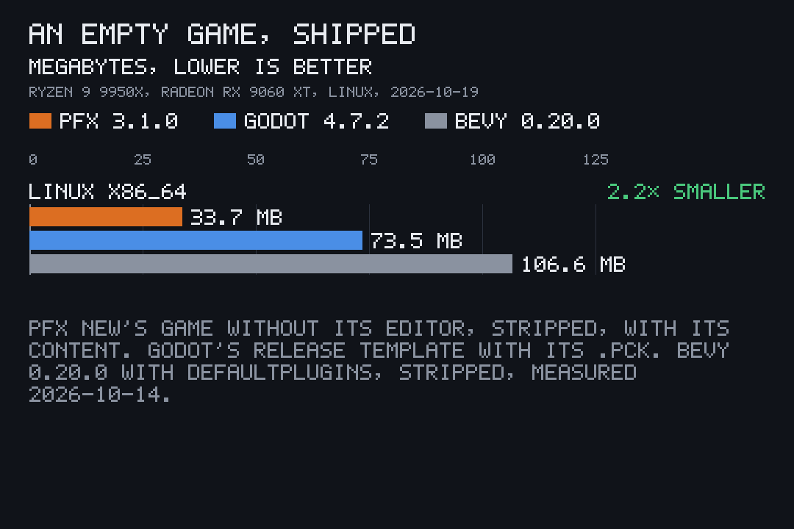

The empty game a player downloads: `pfx new`'s game built `--release --no-default-features` (the game alone, as a Steam build ships it, without the editor) and stripped, beside its `project.toml` and `content/`; Godot's official Linux and Windows release export templates with an empty project exported headless (`--export-release`, the `.pck` beside the binary).

| | basis | Linux x86_64 | Windows x86_64 |
|---|---|---|---|
| pfx v3.1.0 empty game | ≠ | **29.1 MB** binary, **33.7 MB** with its content (the title's meshes, font and scene) | not built |
| Godot 4.7.2 empty export | ≠ | 73.5 MB (73,519,416 bytes of template, 7,152 bytes of `.pck`) | 109.3 MB (109,268,480 + 7,152 bytes) |
| Bevy 0.20.0 empty app, `DefaultPlugins` (above) | ≠ | 106.6 MB | not built |

The same pfx game with its editor (`tools`, the default feature) is 76.1 MB stripped. It took 209 s to build cold from its git dependencies and 80 s more without `tools`, under the machine's build queue; it has 362 dependency crates with the editor and 259 without (`cargo tree -e normal`, unique packages, the game excluded). Godot's templates are prebuilt, so build time is not compared. Godot's empty project scene holds a camera, a light, an environment and a box; pfx's starter holds a camera, a light, a sky, a floor grid with axes and the game's name in 3D.

### Start-up, idle and memory

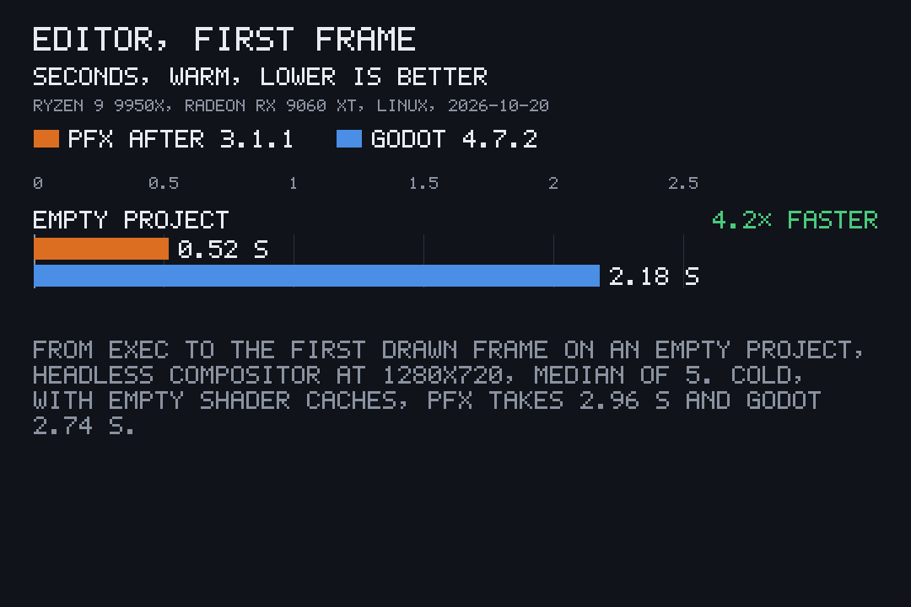
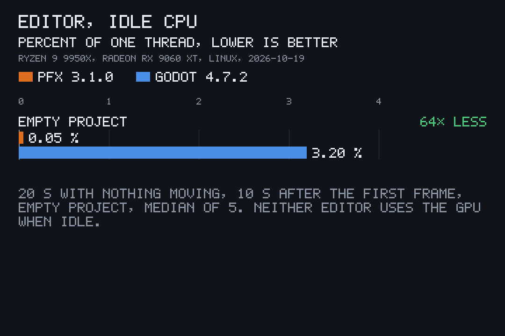
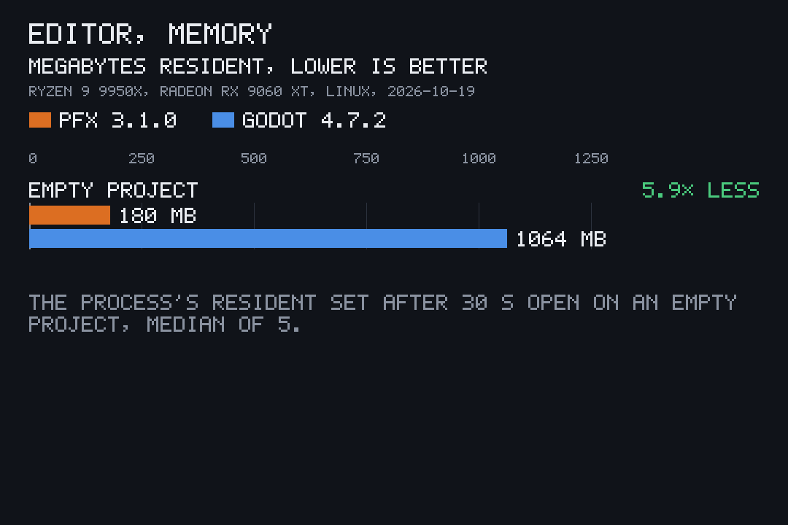

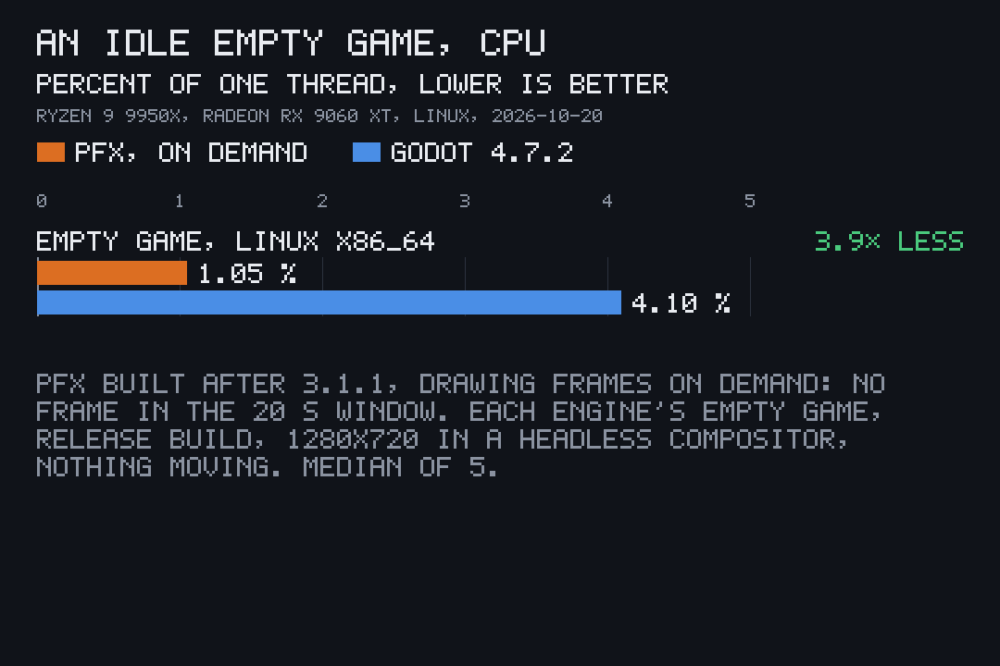
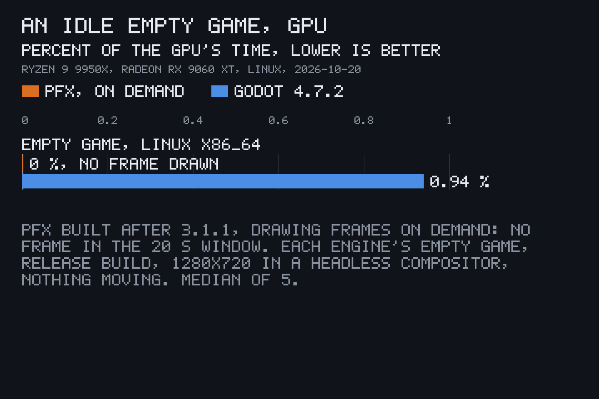

Each program was run in a headless compositor (`cage` on wlroots' headless backend, with a private `/tmp` and its own config, cache and data folders), never on a desktop, at 1280×720 and 60 Hz, with no audio device for either (an empty ALSA configuration and no sound server, so both fall back to running silent). Every run was timed from the program's `exec` to its first drawn frame: pfx's first line of [frame stats](frame-stats.md) (`PFX_FRAME_STATS`), and for Godot a one-line script that writes a file on `RenderingServer.frame_post_draw` (an `EditorPlugin` for the editor, a script on the root node for the game). Cold runs started with empty cache folders, so the GPU driver compiled every shader again, and with the binary dropped from the page cache; warm runs kept the caches of the run before. Idle was read 10 s after the first frame, over 20 s with nothing moving: the process's CPU time from `/proc/<pid>/stat` as a share of one thread, and its GPU time from the DRM `fdinfo` of its device files (`drm-engine-gfx`) as a share of the GPU's time; memory is the process's resident set at the end of the idle window. Both programs alternated run by run, five cold and five warm runs each, under the GPU queue at a load average of 20 to 41; each number is the median of the five.

| | basis | pfx | Godot 4.7.2 |
|---|---|---|---|
| **Editor** on the empty project (`pfx gui <folder>`, `godot -e`): first frame, warm (below) | = | **0.52 s** | 2.18 s |
| first frame, cold | = | 2.96 s | **2.74 s** |
| idle CPU | = | **0.05 %** | 3.2 % |
| idle GPU | = | 0 | 0 |
| memory | = | **180 MB** | 1,064 MB |
| **Empty game** (above, Linux): first frame, warm | ≠ | 0.53 s | **0.40 s** |
| first frame, cold | ≠ | 2.97 s | **1.43 s** |
| idle CPU, drawing frames on demand (below) | ≠ | **1.05 %** | 4.10 % |
| idle GPU, drawing frames on demand | ≠ | **0** | 0.94 % |
| memory | ≠ | **156 MB** | 298 MB |

pfx's editor draws frames only when something changes, so it idles at no GPU time; Godot's editor does the same. pfx's empty game now does too ([frames on demand](#frames-on-demand)): with nothing moving it draws no frame, while its fixed tick still runs. Its two idle rows were measured again on 2026-10-20 with the game built from this tree (`--release --no-default-features`, stripped, on v3.1.0's empty scene), isolated as under [A running game](#a-running-game-with-bevy) and alternating run by run with Godot's empty game (the fullscreen export there), v3.1.0's game and Bevy's, five warm runs each under the GPU queue's bench class at a load average of 18 to 71; medians. pfx presented no frame in the 20 s window, at 1.05 % CPU and no GPU time, against Godot's 4.10 % and 0.94 %. v3.1.0's game in the same series presented 1,200 frames at 9.69 % CPU and 2.86 % GPU, and drawing on demand leaves memory where it was (155.5 MB against 156.0 MB). Godot's empty game still redraws every frame, and pfx's frame (shadows, ambient occlusion, temporal anti-aliasing and the post chain on a lit scene) costs more GPU and CPU time than Godot's when it does draw. The four first-frame rows were measured again on 2026-10-20 with pfx built from this tree after 3.1.1 (`pfx` in the workspace's release profile, and the game as for the idle rows), side by side with Godot in one series: isolated as under [A running game](#a-running-game-with-bevy), pfx's editor on a copy of the same empty project and Godot's on its project with the probe plugin, the game against Godot's fullscreen export there, the four alternating run by run, five cold and five warm each, under the GPU queue's bench class at a load average of 25 to 36; medians. The editor's idle and memory rows and the game's memory are v3.1.0's, from the first series, where v3.1.0 took 23.9 s cold and 0.93 s warm for the editor and 24.3 s and 0.97 s for the game. The game in the first-frame rows is built without the start-up splash ([splash.md](splash.md)), as a game with a pfx Pro key runs, so they time the engine's own start; with the splash, which plays for 2 s over the loading, the game's own first frame came at 2.92 s cold and 2.58 s warm in the same series. Most of v3.1.0's cold start was the GPU driver compiling the path tracer's pipeline, 18 to 23 s, for the scene's reflection cube, which the first frame waited for. The editor, its play view and a game's window now capture that cube on a thread of their own and draw with screen-space reflections and the sky until it lands. The opaque pipeline the first frame needs compiles on a worker while the window and the sky start, and the live frame's other pipelines build on threads of their own. What remains cold is the driver compiling that opaque pipeline, about 2.4 s on RADV, which a player pays once, on the first launch after installing or updating the game or the driver. So pfx's editor draws its first frame 4.2 times sooner than Godot's warm, and 0.2 s later cold. Godot (since 4.4) draws with ubershaders while it compiles its pipelines in the background, so its empty game still draws sooner, cold and warm.

#### The game's first frame

From the program's `exec` to the empty game's first drawn frame, in the 2026-10-20 series above: pfx built from this tree after 3.1.1 (the game `--release --no-default-features`, stripped, on v3.1.0's empty scene) against Godot 4.7.2's empty project exported with the release template, fullscreen and borderless, its project settings at their defaults; each alone in the headless compositor at 1280×720 with its own home, config, cache and data folders, the runs alternating, five cold (empty shader caches, the binary dropped from the page cache) and five warm (the caches of the run before) each, under the GPU queue's bench class at a load average of 25 to 36; medians.

| | basis | cold | warm |
|---|---|---|---|
| pfx empty game, without the start-up splash (as a game with a pfx Pro key runs) | ≠ | 2.97 s | 0.53 s |
| pfx empty game with the start-up splash, as shipped (it plays for 2 s over the loading) | ≠ | 2.92 s | 2.58 s |
| Godot 4.7.2 empty export | ≠ | **1.43 s** | **0.40 s** |

The two games draw different first frames (pfx's starter holds a camera, a light, a sky, a floor grid with axes and the game's name in 3D, drawn with shadows, ambient occlusion, temporal anti-aliasing and the post chain; Godot's a camera, a light, an environment and a box), so the rows are marked ≠.

### A running game, with Bevy

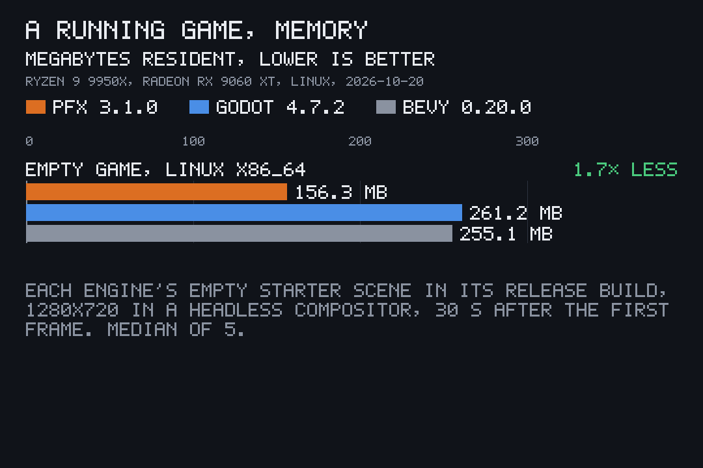

The three empty games side by side on 2026-10-20, in the same headless compositor and with the same method as above, warm, five runs each in turn under the GPU queue's bench class at a load average of 5 to 15, each in its own home, config, cache, data and runtime folders with no display or session bus of the desktop: pfx v3.1.0's empty game (above), Godot 4.7.2's empty project (above) exported again with its window fullscreen and borderless so it draws the whole 1280×720 output, and a Bevy 0.20.0 app with `DefaultPlugins` (its release build, cargo's default profile) drawing the same scene as Godot's: a camera, a sun with shadows, a box and a plain background. The window is 1280×720 for all three, and all three redraw every frame at 60 Hz with nothing moving. Medians:

| | basis | pfx v3.1.0 | Godot 4.7.2 | Bevy 0.20.0 |
|---|---|---|---|---|
| memory | ≠ | **156.3 MB** | 261.2 MB | 255.1 MB |
| idle CPU, share of one thread | ≠ | 7.3 % | **2.7 %** | 41.1 % |
| idle GPU | ≠ | 2.87 % | **0.85 %** | 1.80 % |

pfx's game uses the least memory of the three; on CPU it sits between Godot's and Bevy's, whose multithreaded scheduler keeps its worker threads busy between frames, and on the GPU it costs the most, for the reasons above. Bevy's first frame is not compared: its app has no hook that fires on the first drawn frame, and its pipelines compile in the background while the first frames are drawn without them. Drawing frames on demand, measured in the series under [Start-up, idle and memory](#start-up-idle-and-memory), pfx's game idles at the least of the three: 1.05 % CPU and no GPU time, against Godot's 4.10 % and 0.94 % and Bevy's 46.74 % and 1.79 % in the same runs.

### Build a game from source, with Bevy

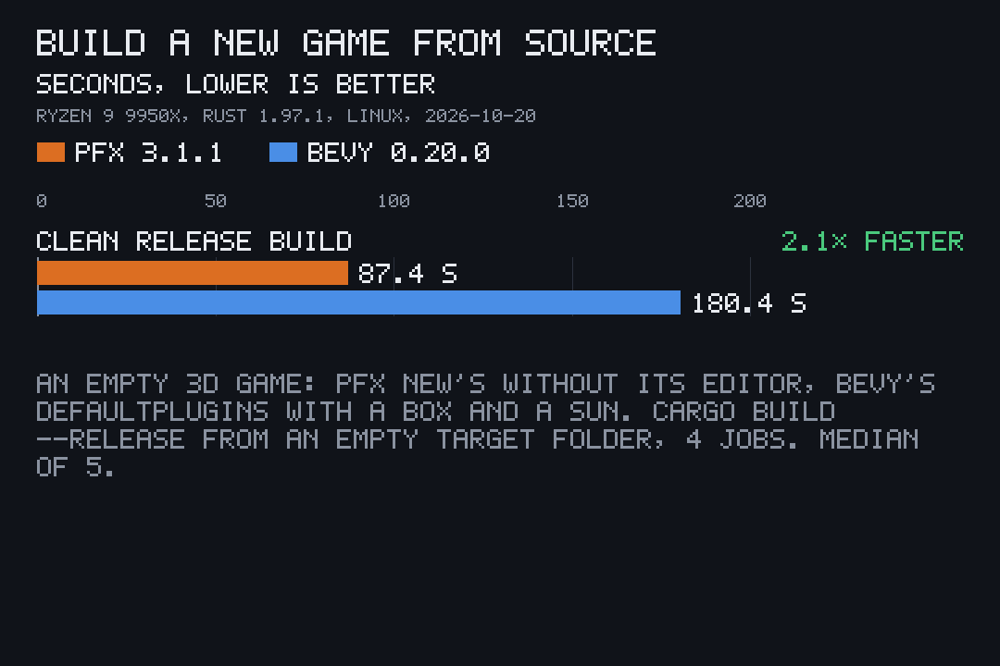
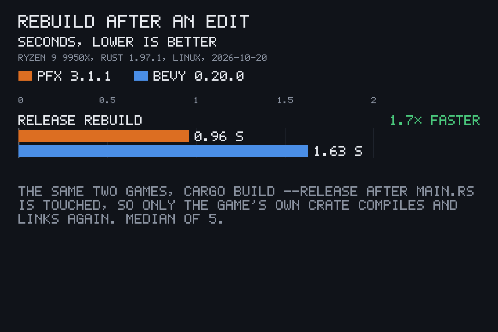

Both engines are Rust crates a game compiles in, so the time to build a game is part of using them. Measured on 2026-10-20 with Rust 1.97.1, cargo's default release profile and this machine's 4 build jobs: the empty game `pfx new` makes with pfx 3.1.1, built as it ships (`cargo build --release --no-default-features`, the game without its editor; 350 build units), against the Bevy 0.20.0 app above (`DefaultPlugins`, a camera, a sun, a box; `cargo build --release`; 510 build units). Each build started from an empty target folder with every dependency already downloaded, and the compiler cache was told to compile every crate again, so nothing came from an earlier build. The rebuild touched `src/main.rs` with the engine already built, so only the game's own crate compiled and linked. Five runs each, in turn (Bevy's fifth clean build ran on its own after the queue's 20-minute limit stopped the series), at a load average of 12 to 32; medians:

| | basis | pfx 3.1.1 | Bevy 0.20.0 |
|---|---|---|---|
| clean release build | = | **87.4 s** | 180.4 s |
| rebuild after `main.rs` is touched | = | **0.96 s** | 1.63 s |
| release binary, unstripped | = | **38.8 MB** | 185.0 MB |

Godot is not in this table: a GDScript game has no compile step, and its export is timed under [Edit from the command line](#edit-from-the-command-line).

### Edit from the command line

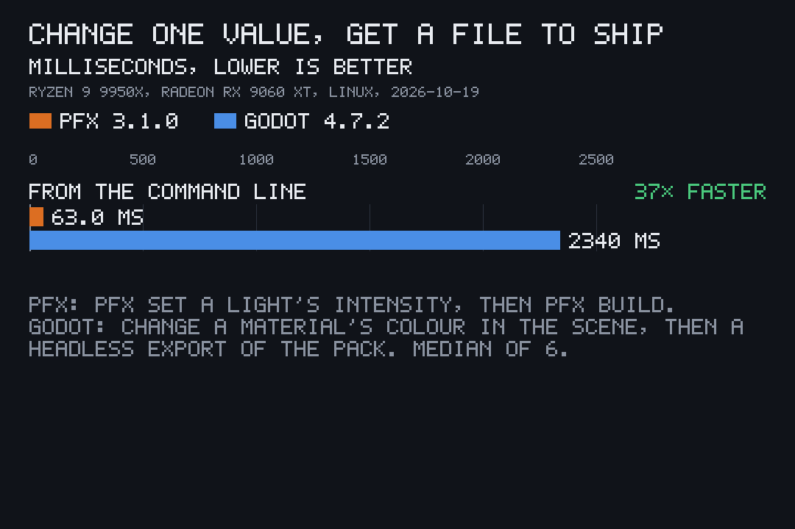

Change one value and get a file to ship, run after run on the same files, medians (six runs each for the light and Godot, alternating; five for the seed):

| | basis | median |
|---|---|---|
| pfx: `pfx set workshop.pitofx light.lamp.intensity=…` then `pfx build workshop.pitofx` (the sample's built glTF reused, since the light changes no mesh) | = | **63 ms** |
| pfx: `pfx set workshop.pitofx seed=…` then `pfx build workshop.pitofx` | = | **85 ms** |
| Godot: change the box's `albedo_color` in `main.tscn`, then `godot --headless --export-pack Linux blank.pck` | = | 2,340 ms |

pfx's scenes are the `.pitofx` files the game reads, so a value set in one needs no export step; Godot's headless export starts its editor each time.

### Import a glTF

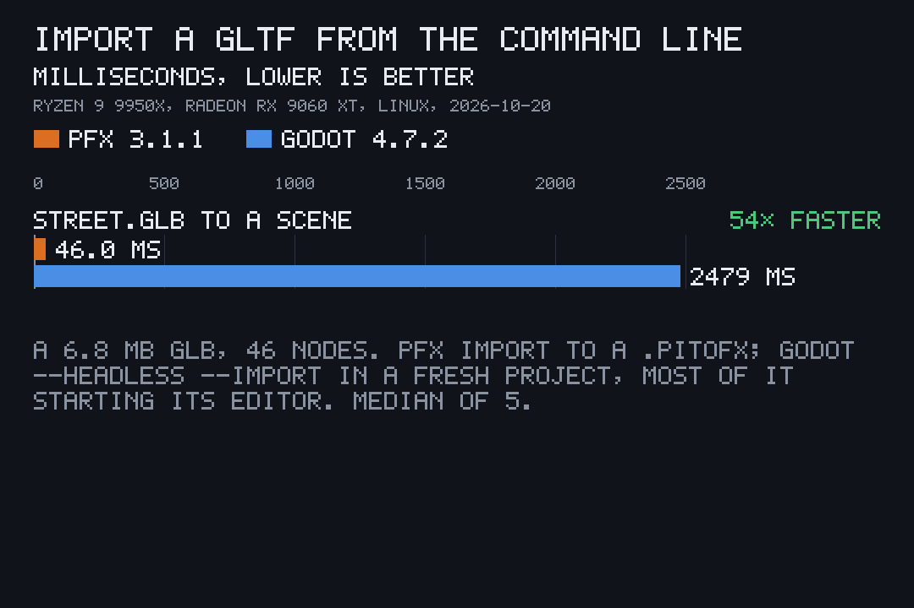

Turn a glTF into the engine's own scene from the command line, measured on 2026-10-20 with pfx 3.1.1 (the release build the machine runs) and Godot 4.7.2. The model is the `street` starter's built `street.glb` (6.8 MB, 46 nodes, no textures): `pfx import street.glb --out street.pitofx`, against `godot --headless --path proj --import` on a fresh project holding the GLB and a one-node main scene, its `.godot` folder and the GLB's `.import` file deleted before each run so the import starts from nothing. Each ran with private home, config, cache and data folders and no display, five times in turn, at a load average of 28 to 33; medians:

| | basis | median |
|---|---|---|
| pfx: `pfx import` to a `.pitofx` | = | **46 ms** |
| Godot: `--headless --import`, its default import settings | ≠ | 2,479 ms |
| Godot: the same with mesh LODs, shadow meshes and tangents off | = | 2,370 ms |
| Godot: `--headless -e --quit` on the imported project, its editor starting alone | = | 2,264 ms |

Most of Godot's time is starting its editor, which a command-line import pays every time; the import itself is the remaining 0.1 to 0.2 s. pfx's `import` reads the GLB and writes the `.pitofx` with no editor to start.

### Frame time on a matched scene

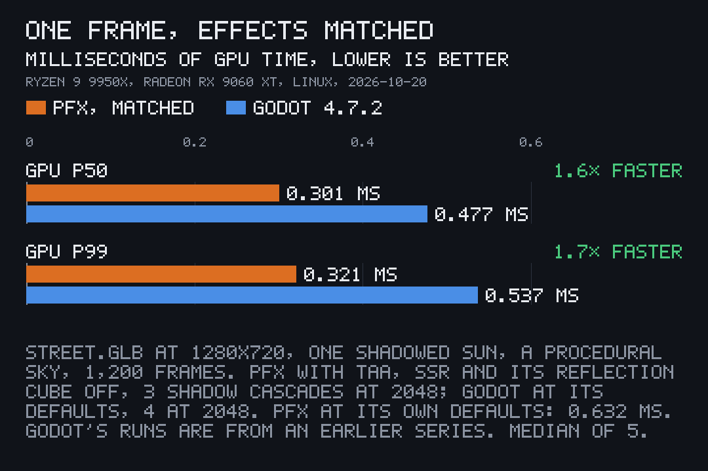

The same `street.glb` (the `street` starter's build, `pfx new street.pitofx --from street --seed 7` then `pfx build`, sha256 `863d6eb4…`) drawn by each engine's live renderer at 1280×720, from the same camera (at 0, 6, −8 looking at 0, 0, 60, a 50° vertical field of view, near 0.05 and far 4,000), lit by one sun with shadows (the same direction) and a procedural sky. pfx: the scene as a `.pitofx` (`[mesh]`, one `[[object]]`, an authored `[sun]`, an analytic `[sky]`, `[camera]`, imported with `pfx scene migrate`), `pfx bench street.pitofx --seconds 20 --size 1280x720`, headless, 1,200 frames, the GPU time of the whole frame from its timestamp queries. Godot 4.7.2: the GLB instanced in a scene with a `WorldEnvironment` (a `ProceduralSkyMaterial` sky), a `DirectionalLight3D` with shadows and a `Camera3D`, exported with the release template and run fullscreen and borderless in the headless compositor above, reading `RenderingServer.viewport_get_measured_render_time_gpu` (the viewport's render, not the final copy to the window) for 1,200 frames after 120 to settle. Every run in its own home, config, cache, data and runtime folders with no display or session bus, under the GPU queue's bench class; the median of five runs' p50 and p99:

| | basis | GPU p50 | GPU p99 |
|---|---|---|---|
| pfx 3.1.1, its defaults, first series | ≠ | 0.932 ms | 0.955 ms |
| pfx built after 3.1.1, its defaults, second series | ≠ | 0.632 ms | 0.648 ms |
| pfx built after 3.1.1, effects matched to Godot's defaults, second series | = | **0.301 ms** | **0.321 ms** |
| Godot 4.7.2, its defaults, first series | = | 0.477 ms | 0.537 ms |

The first series ran on 2026-10-20 at a load average of 16 to 37, pfx and Godot in turn. The second ran later that day, after Godot had been removed from the machine, so Godot's runs were not repeated: the two pfx rows alternated run by run (matched, then defaults, five each) at a load average of 17 to 29. The pfx defaults of the first series did not reproduce: pfx 3.1.1 itself, run once in the second series on the same `.pitofx` as the rerun, took 0.633 ms at p50 and 0.663 ms at p99, so the engine did not change between them; the first series' scene file was not kept, and the cause was not found. The matched row is therefore 0.63 of Godot's p50 across two series, and pfx's defaults are 1.3 times Godot's (second series against first).

Every setting on each side:

| | pfx defaults | pfx matched to Godot's defaults | Godot 4.7.2 defaults |
|---|---|---|---|
| build | the release binary (3.1.1 from its GitHub Release; the rerun built from this tree after 3.1.1) | the same binary as the rerun | 4.7.2-stable, the official release export template, Forward+ |
| scene keys | none beyond the scene above | `[live] taa = false`, `ssr = false`, `scene_reflections = false`; `[shadows] cascades = 3`, `resolution = 2048`, `occlusion = false`, `contact = false` | none beyond the scene above |
| anti-aliasing | temporal (8-frame jitter, history resolve) | off | off (MSAA, screen-space AA and TAA all off) |
| screen-space reflections | on | off | off |
| reflection cube traced from the camera | on | off | none |
| reflections and ambient light where nothing else answers | the sky's light (no probes baked) | the same | the sky (`Background` for both) |
| ambient occlusion | off (`[shadows]` preset `medium`) | off | off (SSAO and SSIL) |
| contact shadows | off | off | none |
| global illumination | none | none | off (SDFGI, VoxelGI) |
| fog | off | off | off (fog and volumetric fog) |
| sun shadows | 3 cascades, 4,096 × 4,096 texels each | 3 cascades, 2,048 × 2,048 each (pfx draws 3 at most) | 4 splits, 2,048 × 2,048 each in a 4,096 atlas, out to 100 m, splits not blended |
| shadow filter | PCF, 1 texel | the same | PCF, "soft low" |
| finish | exposure, ACES tone map and sRGB encode, one fused pass (the standard finish's bloom has strength 0 and is dropped) | the same | linear tone map and sRGB, one pass; glow and debanding off |
| depth prepass | yes | yes | yes |
| mesh levels of detail | none, the full mesh | none | generated on import and picked by distance |

What can't match: pfx draws three sun cascades at most against Godot's four, so the matched row draws one shadow split less at the same per-split resolution; pfx tone maps with ACES where Godot's default is linear, each in one full-screen pass; Godot draws lower levels of detail of far meshes, which pfx's renderer does not do for a mesh it is handed; and each engine fits its cascades its own way. The two GPU times also cover different spans: pfx's is the whole frame, Godot's its viewport's render. Neither number is the CPU's: pfx's bench reports its simulate-and-submit (0.81 ms at p50 matched and 1.03 ms at its defaults in the second series) and Godot its render-thread and frame-setup time (0.38 ms at p50), which time different work. Bevy is not in this table: it reports GPU time per render pass, not per frame.

### The same bytes on every OS

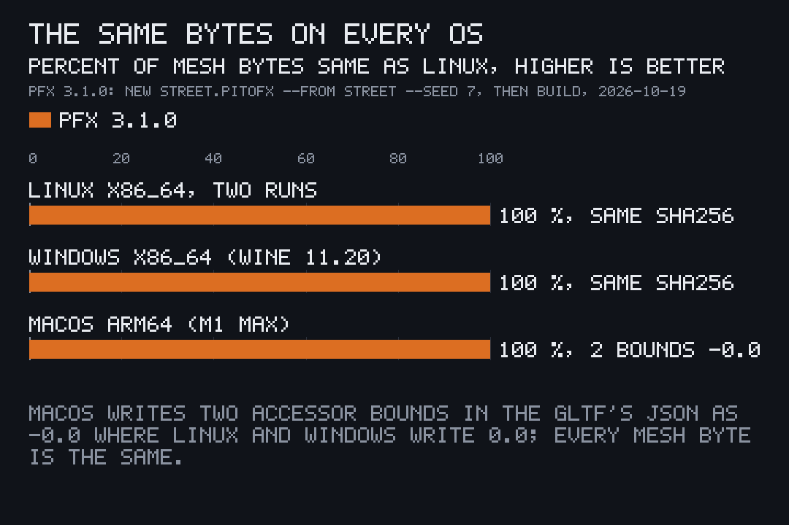

A CPU path, building the `street` starter, ran with pfx v3.1.0's release binary on each OS: `pfx new street.pitofx --from street --seed 7`, then `pfx build street.pitofx --out build`. Linux x86_64 here, Windows x86_64 under Wine 11.20 here, and macOS 26.6 on an Apple M1 Max. The sha256 of each file, each twice on Linux and macOS:

| | `street.pitofx` (3.4 MB) | `build/street.glb` (6.8 MB) |
|---|---|---|
| Linux x86_64 | `64ea15d4…` | `863d6eb4…` |
| Windows x86_64 | `64ea15d4…`, the same | `863d6eb4…`, the same |
| macOS arm64 | `c3c80301…`, differs | `87ff0eae…`, differs |

Linux and Windows write the same bytes. On macOS every mesh byte is the same (the GLB's binary chunk, 6,667,184 bytes, matches byte for byte), and the files differ only in two accessor bounds in the glTF's JSON, written as `-0.0` where Linux and Windows write `0.0`: `f32::min` and `f32::max` may return either zero when given `0.0` and `-0.0`, and ARM's instructions pick the other one. Linux and macOS each gave the same result on both of their runs. So 100 % of the mesh bytes are the same on all three systems.

The GPU paths are the same bytes run after run on the same GPU and driver: time and seeds come from the caller, and nothing reads the clock (`docs/render-a-scene.md`). Across GPU vendors and drivers they are not byte-identical, and no engine promises that: each driver compiles the shaders with its own compiler, which may fuse multiplies and adds differently, WGSL lets `sin`, `exp` and the like differ within their error bounds, and texture filtering and rasterisation follow each vendor's rules within the API's tolerances. They match within those tolerances, not bit for bit.

### Footprint

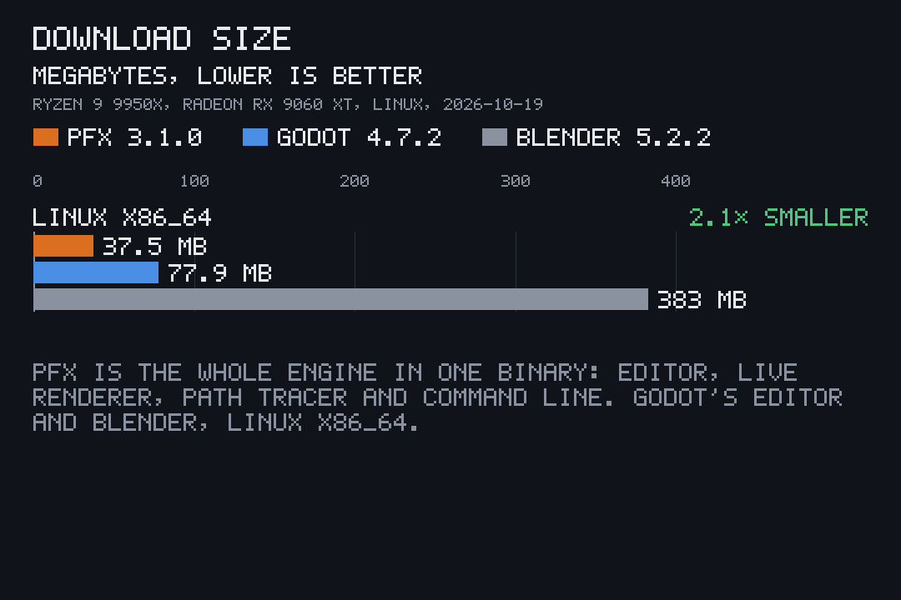
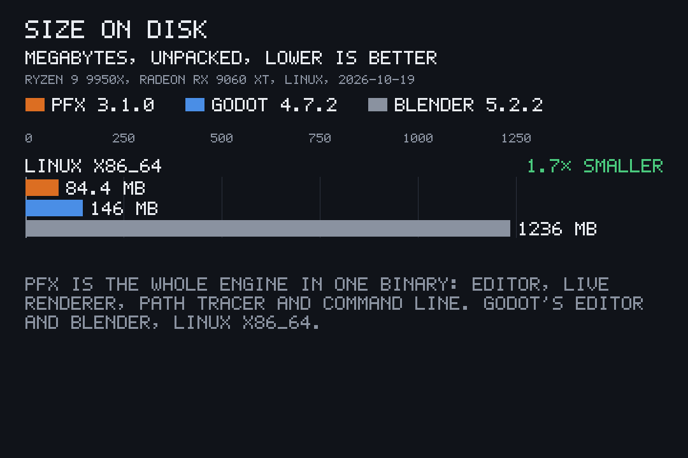

| | basis | download | on disk |
|---|---|---|---|
| pfx v3.1.0, Linux x86_64 (the whole engine, editor, path tracer and command line in one binary) | ≠ | **37.5 MB** | **84.4 MB** |
| pfx v3.1.0, Windows x86_64 | ≠ | 36.2 MB | 81.5 MB |
| pfx v3.1.0, macOS arm64 | ≠ | 31.7 MB | 65.4 MB |
| Godot 4.7.2 editor, Linux x86_64 | ≠ | 77.9 MB | 146.4 MB |
| Godot 4.7.2 export templates, every platform | ≠ | 1,281 MB | |
| Blender 5.2.2, Linux x64 (blender.org/download, which lists it as 366 MB in binary megabytes) | ≠ | 383 MB | 1,236 MB unpacked |
| Unreal Engine 5.8 | ≠ | Epic's requirements pages state no disk space | |

### Modest hardware

The `workshop` sample as a live scene: its recipe with `[output] scene` added and its pixel-space overlay title removed (a scene's text is in scene units), built with `pfx build`, then `pfx bench workshop.pitofx --seconds 20` (1,200 frames, headless, under the GPU queue's bench class), five runs each, the median of the runs' p50 and p99.

| | GPU p50 | GPU p99 | CPU (submit) p50 | CPU p99 |
|---|---|---|---|---|
| 1920×1080, this machine | **2.95 ms** | 2.98 ms | 1.17 ms | 2.14 ms |
| 1280×800, a Steam Deck LCD's CPU | 1.57 ms here | 1.59 ms here | 1.05 ms | 1.99 ms |

The second row ran in a Steam Deck LCD profile: 4 cores and their 8 threads on the second die, held to 312 % of one thread (a Deck thread does about 0.39 of one here: the Zen 2's clock and three generations of IPC), 12 GB of memory and 1 GB of swap. The CPU's frame takes about 2 ms at p99, an eighth of a 60 fps frame. The GPU was not slowed: capping its clock needs root and changes the desktop's GPU state, so it was not done. The Deck's GPU is about 6 times slower than this one (8 RDNA 2 compute units at 1.0 to 1.6 GHz against 32 RDNA 4 ones at up to about 3.1 GHz, and published game benchmarks), so a Deck frame is estimated at about 9.4 ms of GPU time at p50, inside the 16.7 ms budget; that is an estimate, not a measurement. A real low-end GPU has not been measured.

For scale, Epic's published requirements for Unreal Engine 5.8 (dev.epicgames.com, "Hardware and Software Specifications" and "Linux Development Requirements", read on 2026-10-19) recommend a quad-core 2.5 GHz CPU, 32 GB of RAM and a GeForce 2080 or another GPU with 8 GB of VRAM, and state no minimum hardware. Blender 5.x asks for at least 4 cores, 8 GB of RAM and 2 GB of VRAM, and recommends 8 cores, 32 GB and 8 GB (blender.org/download/requirements).

## Lines of Rust

About 463,000 lines in 43 crates, counted on 2026-10-18 after the fold with `wc -l` over every `.rs` file under `crates/*/src` and `src`.
