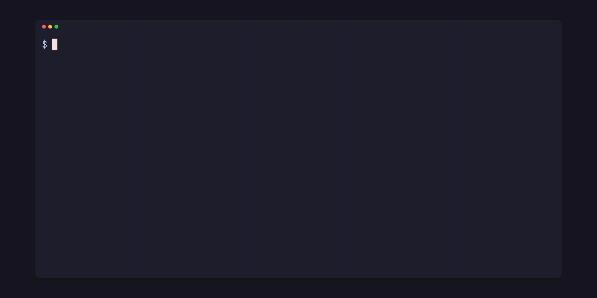

# Check a project

<p align="center"></p>

`Project::check` checks every file of a project: each scene with everything it reads, each prefab on its own, and every include, prefab, reference, id and asset path. It returns a list of `Diagnostic`s, empty when the project is clean.

## From the command line

The crate's `scene-check` example runs it on a folder: a game's folder of scene `.pitofx` files, each checked with the files inside it, or a loose project such as the crate's demo, whose scene entry is `scenes/room.scene.toml`. On a copy of the demo with two mistakes, a mesh path written `assets/Ball.gltf` and the lamp's material written `bras`:

```sh
cargo run --release -p pfx-scene --example scene-check -- my-copy
```

```text
error[path-case]: path assets/Ball.gltf is found only as assets/ball.gltf; paths keep their case
  --> scenes/room.scene.toml:10:8
   |
10 | file = "assets/Ball.gltf"
   |        ^^^^^^^^^^^^^^^^^^

error[bad-reference]: bras names no material of the scene's libraries
  --> scenes/room.scene.toml:28:12
   |
28 | material = "bras"
   |            ^^^^^^

2 errors
```

It exits with 1 when it finds an error. With both fixed:

```text
scenes/room.scene.toml: 6 objects, 2 prefab placements, 3 bodies, 1 light, 2 materials
no errors
```

The case mistake would pass on Windows and macOS, whose disks usually ignore case, and fail on Linux; the checker refuses it on every system.

## From code

```rust
use std::path::Path;

use pfx_scene::Project;

fn main() {
    let project = match Project::open(Path::new("my-game")) {
        Ok(project) => project,
        Err(diagnostic) => {
            eprintln!("{diagnostic}");
            return;
        }
    };
    let findings = project.check();
    for d in &findings {
        println!("{}:{}:{} {} [{}] {}", d.file.display(), d.line, d.column, d.severity, d.code, d.message);
    }
    let errors = findings.iter().filter(|d| d.is_error()).count();
    println!("{errors} errors");
}
```

Each `Diagnostic` has:

- `file`, relative to the project root, and `line`, `column`, `end_line`, `end_column`: 1-based, columns counting characters, the end just past the span.
- `severity`: `Error` or `Warning`. A warning, such as `missing-id` or `old-format`, doesn't stop a scene from loading.
- `code`: a stable string such as `bad-reference`, `path-case`, `missing-key`, `bad-type`, `duplicate-id` or `include-cycle`. `pfx_scene::code::ALL` lists every code, and [the format](scene-format.md) says when each is given.
- `key`, the key the finding is about, and `message`, in plain words.
- `related`: other places involved, such as the first holder of a duplicate id, or each include of a cycle.

Printing a `Diagnostic` with `{}` gives the `scene-check` style above, without the source lines.

## What `Project::open` reads

`Project::open` finds the files under the root by their names. It skips the root's `target` and `tmp` folders, the paths `[project] ignore` lists, names that start with a dot, and folders that hold their own `project.toml`. A file a scene names inside a skipped folder is still read and checked with that scene.
