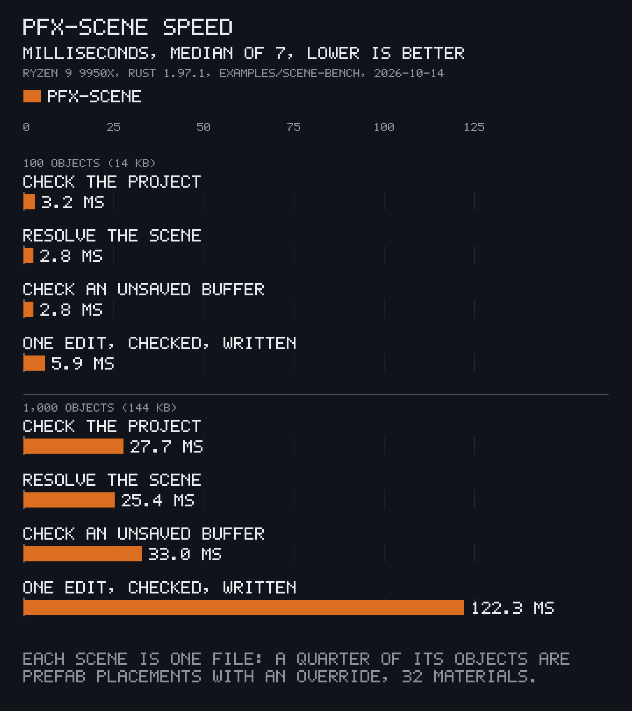

# Measure the speed

<p align="center"></p>

| Objects in the scene | 100 | 1,000 | 10,000 |
|---|---|---|---|
| Scene file size | 14 KB | 144 KB | 1.4 MB |
| `Project::check`, the whole project | 3.2 ms | 27.7 ms | 418 ms |
| `Project::scene`, resolve | 2.8 ms | 25.4 ms | 360 ms |
| `check`, an unsaved buffer | 2.8 ms | 33.0 ms | 432 ms |
| `SceneEdit::open` | 6.2 ms | 44.6 ms | 664 ms |
| One `set_at`, checked and written | 5.9 ms | 122 ms | 990 ms |

Measured once on 2026-10-14, on the earlier standalone crate (pfx-scene 1.6.0), on an AMD Ryzen 9 9950X under Linux with Rust 1.97.1, while the machine was busy with other work; nothing was re-run. The times grow faster than the object count from 1,000 objects up.

The chart above draws the 100 and 1,000 object columns. It was drawn in that earlier repository; `bin/charts` does not redraw it, and it is not one of the charts of `docs/charts`.

## Measure it yourself

The `scene-bench` example writes a project per size into a folder of your choice and prints the median of 7 runs of each step:

```sh
cargo run --release -p pfx-scene --example scene-bench -- tmp/bench 100 1000 10000
```

```text
objects  bytes  open ms  check ms  resolve ms  buffer check ms  edit open ms  edit ms
    100  14418     0.03      1.59        1.73             1.78          2.50     6.74
   1000  144322     0.05     28.86       23.57            24.27         36.70    75.90
```

Each project has one scene file: a quarter of its objects are prefab placements with an override, a quarter carry rigid bodies, the scene names 32 materials, and `Project::fix` fills the ids. The sizes default to 1,000 and 10,000. Numbers move from run to run with the machine's load; the sample above came from a later run than the table.
